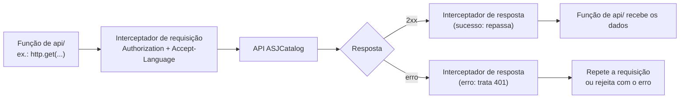

[← README](../README.md) · [Anterior](ROUTES-AND-PAGES.md) · [Próximo](AUTHENTICATION.md)

# API e services

Este documento explica como o frontend conversa com a API ASJCatalog. Você vai conhecer a instância do Axios usada em todas as chamadas, o que os interceptadores fazem, a divisão de responsabilidades entre `api/` e `services/`, a lista completa de endpoints consumidos, como as respostas paginadas são normalizadas e como adicionar um endpoint novo seguindo o padrão do projeto.

## Onde fica no código

| Arquivo | Papel |
| --- | --- |
| `frontend/src/api/axios.ts` | Cria a instância `http` e registra os interceptadores |
| `frontend/src/api/base-url.ts` | Decide o endereço base das requisições |
| `frontend/src/api/auth-api.ts` | Pedido e renovação de token (fora da instância `http`) |
| `frontend/src/api/account-api.ts` | Conta do usuário: cadastro, ativação, senha, perfil |
| `frontend/src/api/product-api.ts` | Produtos |
| `frontend/src/api/category-api.ts` | Categorias |
| `frontend/src/api/user-api.ts` | Usuários (administração) |
| `frontend/src/services/*.ts` | Ponto de acesso das telas às funções de `api/` |
| `frontend/src/utils/constants.ts` | Objeto `ENDPOINTS`, com os caminhos da API |
| `frontend/src/types/` | Tipos das requisições e respostas (`ProductResponse`, `SpringPage<T>`…) |

## A instância HTTP

Todas as chamadas comuns à API usam uma única instância do **Axios** (biblioteca de requisições HTTP, *HyperText Transfer Protocol*), exportada como `http`:

`frontend/src/api/axios.ts`

```ts
export const http = axios.create({
  baseURL: getHttpBaseUrl(),
});
```

- **`baseURL`**: endereço que o Axios coloca antes de cada caminho. Com ele, as funções escrevem só `/api/v1/products`, e não o endereço completo. O valor vem de `getHttpBaseUrl()`, que normalmente devolve `VITE_API_BASE_URL`. Os detalhes estão em [ENVIRONMENT-AND-SETUP.md](ENVIRONMENT-AND-SETUP.md#como-o-frontend-chega-à-api).
- **Cabeçalhos padrão:** a instância não define nenhum. Os cabeçalhos são adicionados pelo interceptador de requisição (próxima seção). Quando a requisição tem corpo, o próprio Axios coloca `Content-Type: application/json`.
- **Timeout:** não configurado. Uma requisição sem resposta fica pendente até o navegador desistir.
- **`withCredentials`:** não configurado. O frontend não envia cookies; a sessão vai no cabeçalho `Authorization`.

O pedido de token (`/oauth2/token`) **não** usa essa instância. Ele usa o `axios` global, de propósito, para não passar pelos interceptadores. O motivo está em [AUTHENTICATION.md](AUTHENTICATION.md).

## Interceptadores

Um **interceptador** é uma função que o Axios executa automaticamente em toda requisição (antes de enviar) ou em toda resposta (antes de entregar ao código que chamou).



### Requisição: adiciona cabeçalhos

`frontend/src/api/axios.ts`

```ts
http.interceptors.request.use((config) => {
  const session = getAuthData();
  if (session?.access_token) {
    config.headers = config.headers ?? {};
    (config.headers as Record<string, string>).Authorization = `Bearer ${session.access_token}`;
  }
  config.headers = config.headers ?? {};
  (config.headers as Record<string, string>)["Accept-Language"] = getAcceptLanguageHeader();
  return config;
});
```

1. Lê a sessão salva no `localStorage`. Se houver um token de acesso, adiciona `Authorization: Bearer <token>`.
2. Sempre adiciona `Accept-Language` com o idioma ativo da interface, por exemplo `pt-BR,pt;q=0.9`. A API usa esse cabeçalho para devolver mensagens no idioma certo.

Por isso, as funções de `api/` e as telas **nunca** montam esses cabeçalhos manualmente.

### Resposta: trata o 401

Respostas de sucesso passam direto (`(res) => res`). Em caso de erro, o interceptador só age quando o código é **401** (não autorizado):

- **Há refresh token salvo e a requisição ainda não foi repetida:** tenta renovar a sessão, troca o token no cabeçalho e repete a requisição **uma única vez** (a marca `_retry` impede repetições infinitas).
- **A renovação falha:** encerra a sessão e, se o usuário estiver numa página privada, leva-o ao login.
- **Não há refresh token:** só encerra a sessão se o token local estiver ausente ou expirado. Um 401 com token ainda válido é repassado para a tela tratar.

Qualquer outro erro (400, 403, 404, 500, falha de rede) é repassado sem alteração. Quem o interpreta é a tela, com os utilitários descritos em [ERROR-HANDLING.md](ERROR-HANDLING.md). A renovação de sessão está detalhada em [AUTHENTICATION.md](AUTHENTICATION.md#renovação-da-sessão-refresh).

## `api/` e `services/`: quem faz o quê

| | `api/` | `services/` |
| --- | --- | --- |
| Responsabilidade | Montar a requisição (método, caminho, parâmetros, corpo), enviar com `http` e devolver os dados já extraídos da resposta (`r.data`) | Ser o ponto de acesso das telas aos dados |
| Quem usa | Os services (e, como exceção, o `AuthContext` e o próprio `axios.ts`) | As telas (`pages/`) e o `AuthContext` |
| Conhece React? | Não | Não |
| Trata erros? | Não: deixa o erro do Axios seguir | Não (exceção: `authService.getCurrentUser` devolve `null` em caso de erro) |

Hoje, a maioria dos services só **reexporta** a `api/`:

| Service | O que é |
| --- | --- |
| `productService` | O próprio `productApi` |
| `categoryService` | O próprio `categoryApi` |
| `accountService` | O próprio `accountApi`, mais a função `updateOwnPassword` |
| `userService` | Tudo de `userApi`, mais `updateAuthenticatedUser` |
| `authService` | `login`, `logout`, `isAuthenticated` e `getCurrentUser`, que combinam `api/` e `utils/storage.ts` |

### Exemplo de ponta a ponta: atualizar os próprios dados

A tela de dados pessoais chama o service:

`frontend/src/pages/account/PersonalProfilePage.tsx`

```tsx
      await userService.updateAuthenticatedUser({
        firstName: data.firstName.trim(),
        lastName: data.lastName.trim(),
        email: data.email.trim(),
      });
```

O service acrescenta essa função aos métodos de `userApi` e a liga à API de conta:

`frontend/src/services/user-service.ts`

```ts
export const userService = {
  ...userApi,

  /** Atualiza os dados do próprio usuário autenticado (PUT /api/v1/accounts/me). */
  updateAuthenticatedUser: (data: AuthenticatedUserUpdateRequest) => accountApi.updateMe(data),
};
```

A função de `api/` faz a requisição e devolve o corpo da resposta:

`frontend/src/api/account-api.ts`

```ts
  updateMe: (data: AuthenticatedUserUpdateRequest) =>
    http.put<User>(ENDPOINTS.accountsMe, data).then((r) => r.data),
```

O caminho completo fica: `PersonalProfilePage` → `userService.updateAuthenticatedUser` → `accountApi.updateMe` → `PUT /api/v1/accounts/me`.

## Endpoints consumidos

Os caminhos ficam no objeto `ENDPOINTS` de `frontend/src/utils/constants.ts`.

### Autenticação e conta

| Método | Rota | Função de api | Função de service | Tela ou módulo que usa |
| --- | --- | --- | --- | --- |
| POST | `/oauth2/token` (`grant_type=password`) | `requestToken` | `authService.login` | `LoginPage` (via `AuthContext.login`) |
| POST | `/oauth2/token` (`grant_type=refresh_token`) | `refreshTokenRequest` (via `refreshSession`) | — (chamada direta) | `AuthContext` e interceptador de `axios.ts` |
| GET | `/api/v1/accounts/me` | `accountApi.me` | `authService.getCurrentUser` | `AuthContext` (alimenta Navbar, Dashboard e perfil) |
| PUT | `/api/v1/accounts/me` | `accountApi.updateMe` | `userService.updateAuthenticatedUser` | `PersonalProfilePage` |
| PATCH | `/api/v1/accounts/me/password` | `accountApi.updatePassword` | `updateOwnPassword` (account-service) | `SecurityProfilePage` |
| POST | `/api/v1/accounts/register` | `accountApi.register` | `accountService.register` | `RegisterPage` |
| GET | `/api/v1/accounts/activate?token=` | `accountApi.activate` | `accountService.activate` | `ActivateAccountPage` |
| POST | `/api/v1/accounts/resend-activation` | `accountApi.resendActivation` | `accountService.resendActivation` | `ActivationPendingPage`, `ActivateAccountPage` |
| POST | `/api/v1/accounts/password-recovery` | `accountApi.requestPasswordRecovery` | `accountService.requestPasswordRecovery` | `RecoverPage` |
| POST | `/api/v1/accounts/reset-password` | `accountApi.resetPassword` | `accountService.resetPassword` | `ResetPasswordPage` |

### Produtos

| Método | Rota | Função de api | Função de service | Tela que usa |
| --- | --- | --- | --- | --- |
| GET | `/api/v1/products?page&size&sort&name&categoryIds` | `productApi.findAll` | `productService.findAll` | `CatalogPage`, `ProductListPage`, `DashboardPage` (total) |
| GET | `/api/v1/products/{id}` | `productApi.findById` | `productService.findById` | `ProductDetailsPage`, `ProductForm` (edição) |
| POST | `/api/v1/products` | `productApi.create` | `productService.create` | `ProductForm` (criação) |
| PUT | `/api/v1/products/{id}` | `productApi.update` | `productService.update` | `ProductForm` (edição) |
| DELETE | `/api/v1/products/{id}` | `productApi.delete` | `productService.delete` | `ProductListPage` |

### Categorias

| Método | Rota | Função de api | Função de service | Tela que usa |
| --- | --- | --- | --- | --- |
| GET | `/api/v1/categories?page&size&sort&name` | `categoryApi.findPage` | `categoryService.findPage` | `CategoryListPage`, `DashboardPage` (total) |
| GET | `/api/v1/categories` (todas as páginas) | `categoryApi.findAll` | `categoryService.findAll` | `CatalogPage` e `ProductListPage` (filtro), `ProductForm` (seleção de categorias) |
| GET | `/api/v1/categories/{id}` | `categoryApi.findById` | `categoryService.findById` | `CategoryForm` (edição) |
| POST | `/api/v1/categories` | `categoryApi.create` | `categoryService.create` | `CategoryForm` (criação) |
| PUT | `/api/v1/categories/{id}` | `categoryApi.update` | `categoryService.update` | `CategoryForm` (edição) |
| DELETE | `/api/v1/categories/{id}` | `categoryApi.delete` | `categoryService.delete` | `CategoryListPage` |

### Usuários (administração)

| Método | Rota | Função de api | Função de service | Tela que usa |
| --- | --- | --- | --- | --- |
| GET | `/api/v1/users?page&size&sort&firstName` | `userApi.findAll` | `userService.findAll` | `UserListPage`, `DashboardPage` (total, só para `ROLE_ADMIN`) |
| GET | `/api/v1/users/{id}` | `userApi.findById` | `userService.findById` | `UserDetailsPage`, `UserForm` (edição) |
| POST | `/api/v1/users` | `userApi.create` | `userService.create` | `UserForm` (criação) |
| PUT | `/api/v1/users/{id}` | `userApi.update` | `userService.update` | `UserForm` (edição) |
| DELETE | `/api/v1/users/{id}` | `userApi.delete` | `userService.delete` | `UserListPage` |
| POST | `/api/v1/users/register` | `userApi.register` | `userService.register` | **Nenhuma tela** |
| PATCH | `/api/v1/users/{id}/activate` | `userApi.activate` | `userService.activate` | **Nenhuma tela** |
| PATCH | `/api/v1/users/{id}/deactivate` | `userApi.deactivate` | `userService.deactivate` | **Nenhuma tela** |

### Parâmetros padrão das listagens

Quando a tela não informa um parâmetro, a função de `api/` usa um valor padrão:

| Função | `page` | `size` | `sort` | Outros |
| --- | --- | --- | --- | --- |
| `productApi.findAll` | `0` | `12` | `name,asc` | `name: ""`, `categoryIds: "0"` |
| `categoryApi.findPage` | `0` | `10` | `name,asc` | `name` só é enviado se tiver valor |
| `categoryApi.findAll` | — | `200` | `name,asc` | Busca a primeira página e, se houver mais, as demais |
| `userApi.findAll` | `0` | `20` | `firstName,asc` | `firstName` opcional |

As telas costumam sobrescrever `page` e `size`. Por exemplo, o catálogo usa `size: 10`.

## Respostas paginadas (SpringPage)

A API devolve listas no formato de página do Spring (framework Java usado no backend). O frontend descreve esse formato com o tipo `SpringPage<T>`:

`frontend/src/types/product.ts`

```ts
export type SpringPage<T> = {
  content: T[];
  totalElements: number;
  totalPages: number;
  number: number;
  size: number;
};
```

| Campo | Significado |
| --- | --- |
| `content` | Itens da página atual |
| `totalElements` | Total de itens em todas as páginas |
| `totalPages` | Quantidade de páginas |
| `number` | Número da página atual (começa em 0) |
| `size` | Tamanho de página usado |

`types/index.ts` também exporta `Paginated<T>`, um **apelido** (*alias*) com o mesmo formato, criado para novas assinaturas não dependerem do nome do backend. As funções de produtos e categorias usam `Paginated`; a de usuários usa `SpringPage`.

### Normalização

As funções de listagem aceitam duas formas de resposta: a página do Spring ou um array simples. Se vier um array, ele é convertido numa página única, e as telas sempre recebem o mesmo formato:

`frontend/src/api/product-api.ts`

```ts
    return http
      .get<SpringPage<ProductResponse> | ProductResponse[]>(ENDPOINTS.products, {
        params: merged,
      })
      .then((r) => {
        const data = r.data;
        if (Array.isArray(data)) {
          return {
            content: data,
            totalElements: data.length,
            totalPages: 1,
            number: 0,
            size: data.length,
          } satisfies SpringPage<ProductResponse>;
        }
        return data;
      });
```

O mesmo bloco se repete em `categoryApi.findPage` e `userApi.findAll`.

`categoryApi.findAll` vai além: pede a primeira página com `size: 200` e, se `totalPages` indicar mais páginas, busca as restantes em paralelo e junta tudo num único array de `Category`.

Do lado das telas, quem consome essas páginas é o hook `usePagedQuery`, documentado em [HOOKS.md](HOOKS.md#usepagedquery).

## Como adicionar um novo endpoint

Exemplo hipotético: buscar as categorias de um produto.

1. **Caminho:** se for um recurso novo, acrescente o caminho em `ENDPOINTS` (`frontend/src/utils/constants.ts`). Para sub-recursos de um caminho existente, monte a URL a partir dele, como o projeto já faz com `` `${ENDPOINTS.products}/${id}` ``.
2. **Tipos:** declare os tipos da requisição e da resposta em `frontend/src/types/` e exporte-os pelo `types/index.ts`.
3. **Função de api:** acrescente a função ao objeto do domínio (`productApi`, `categoryApi`…), usando `http` e devolvendo `r.data`:
   ```ts
   findCategories: (id: number) =>
     http.get<Category[]>(`${ENDPOINTS.products}/${id}/categories`).then((r) => r.data),
   ```
4. **Service:** se o service do domínio for um apelido (`productService = productApi`) ou espalhar a api (`...userApi`), a função nova já aparece nele. Se precisar combinar chamadas ou adaptar dados, faça isso no service.
5. **Tela:** chame o **service**, nunca a `api/` diretamente. Para carregar dados, prefira os hooks existentes (`useResource` para um item, `usePagedQuery` para listas).
6. **Erros:** trate-os com os utilitários de [ERROR-HANDLING.md](ERROR-HANDLING.md). Não leia `err.response` diretamente.
7. **Cabeçalhos:** não adicione `Authorization` nem `Accept-Language`; o interceptador já faz isso.

## Cuidados e limitações

- **Sem timeout:** a instância `http` não define `timeout`. Se a API travar, a tela fica em "carregando" indefinidamente.
- **Services finos:** a maioria dos services só repete a `api/`. A camada existe, mas quase não tem lógica.
- **Funções duplicadas:** `updateOwnPassword` faz o mesmo que `accountApi.updatePassword`, e `userService.updateAuthenticatedUser` faz o mesmo que `accountApi.updateMe`. Além disso, um endpoint de conta é oferecido pelo service de usuários.
- **Código sem uso:** `userApi.register`, `userApi.activate` e `userApi.deactivate` (e o caminho `ENDPOINTS.usersRegister`) não são chamados por nenhuma tela.
- **Normalização repetida:** o bloco que converte array em página aparece três vezes.
- **Tipos inconsistentes:** `categoryApi.update` recebe uma `Category` completa (com `id` no corpo), enquanto `create` recebe `CategoryRequest`; `Paginated` e `SpringPage` são usados misturados.
- **Inversão de camada:** `api/axios.ts` importa `routes/route-access.ts` e `i18n/http.ts`. Veja [ARCHITECTURE.md](ARCHITECTURE.md#mapa-de-dependências-entre-módulos).

## Veja também

- [AUTHENTICATION.md](AUTHENTICATION.md): pedido de token, renovação de sessão e logout.
- [ERROR-HANDLING.md](ERROR-HANDLING.md): como os erros das requisições são interpretados e exibidos.
- [ENVIRONMENT-AND-SETUP.md](ENVIRONMENT-AND-SETUP.md): endereço base da API, proxy e CORS.
- [ARCHITECTURE.md](ARCHITECTURE.md): camadas e fluxo de uma requisição.
- [GLOSSARY.md](GLOSSARY.md): significado dos termos técnicos usados aqui.
