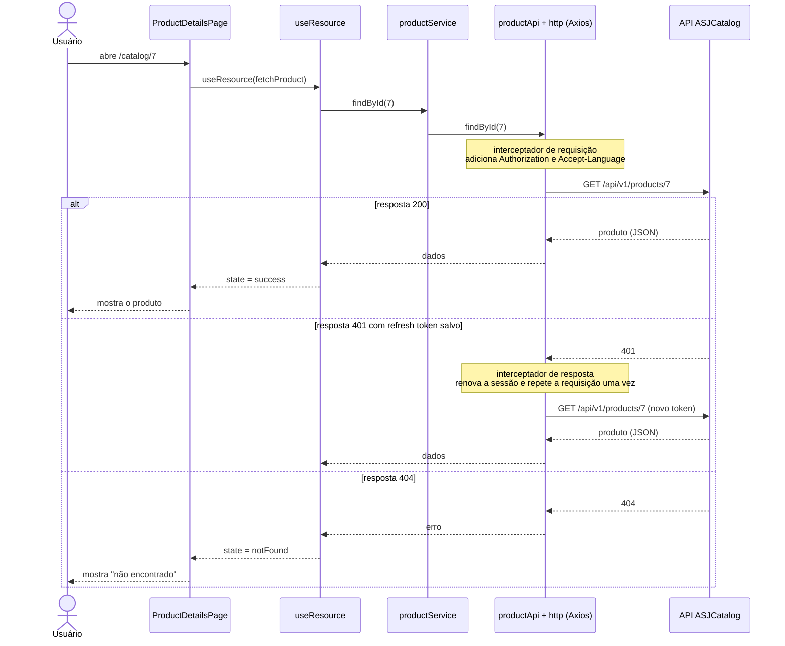
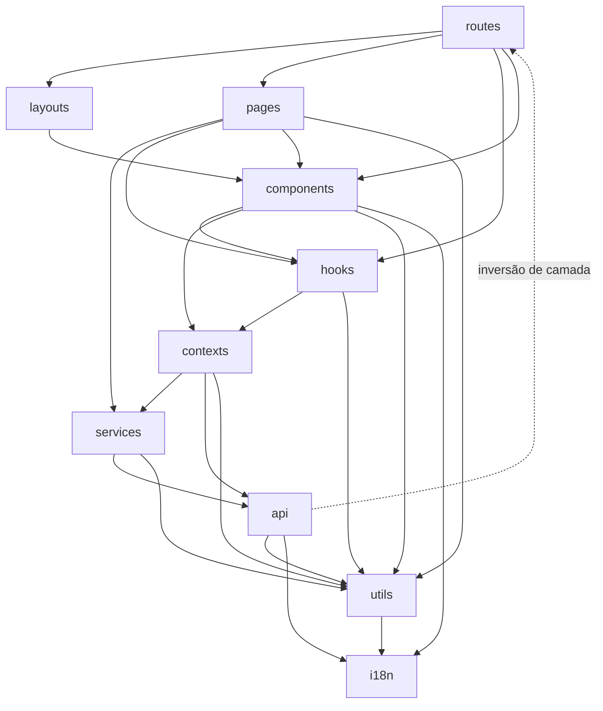

[← README](../README.md) · [Próximo](ENVIRONMENT-AND-SETUP.md)

# Arquitetura

Este documento mostra como o frontend do ASJCatalog está organizado. Você vai entender as camadas do projeto, o caminho que uma requisição percorre do clique até a resposta da API, o papel de cada pasta de `frontend/src` e quem depende de quem.

## Onde fica no código

| Arquivo ou pasta | Papel |
| --- | --- |
| `frontend/index.html` | Página HTML única carregada pelo navegador |
| `frontend/src/main.tsx` | Ponto de entrada: monta o React na `<div id="root">` |
| `frontend/src/App.tsx` | Empilha os providers globais e as rotas |
| `frontend/src/routes/AppRoutes.tsx` | Mapa de rotas (qual URL abre qual tela) |
| `frontend/src/pages/` | Telas |
| `frontend/src/services/` | Camada entre as telas e a `api/` |
| `frontend/src/api/` | Requisições HTTP (*HyperText Transfer Protocol*) com Axios |

## Visão geral

O frontend é uma **SPA** (*Single Page Application*, aplicação de página única). O navegador baixa um único `index.html` e um pacote de JavaScript. A partir daí, a troca de telas acontece no próprio navegador, sem recarregar a página. Os dados vêm da **API ASJCatalog**, uma API REST (serviço que responde a requisições HTTP com dados em JSON).

A inicialização segue esta ordem:

1. `index.html` carrega `src/main.tsx`.
2. `main.tsx` renderiza o componente `App`.
3. `App` envolve as rotas com os **providers** (componentes que disponibilizam dados para toda a árvore abaixo deles).

`frontend/src/App.tsx`

```tsx
export default function App() {
  return (
    <ThemeProvider>
      <I18nProvider>
        <BrowserRouter>
          <AuthProvider>
            <AppRoutes />
          </AuthProvider>
        </BrowserRouter>
      </I18nProvider>
    </ThemeProvider>
  );
}
```

Cada provider só fica disponível para o que está **dentro** dele. O `ThemeProvider` e o `I18nProvider` ficam por fora do roteador, então tema e idioma já existem antes de qualquer rota. O `AuthProvider` fica dentro do `BrowserRouter` e envolve diretamente as rotas.

## As camadas: pages → services → api

O projeto separa as responsabilidades em três camadas:

| Camada | Pasta | Responsabilidade |
| --- | --- | --- |
| Tela | `pages/` | Mostra a interface, guarda o estado da tela (carregando, erro, dados) e chama os services |
| Serviço | `services/` | Ponto de acesso das telas aos dados. Hoje, na maioria dos casos, apenas reexporta a `api/` |
| API | `api/` | Monta e envia as requisições HTTP e normaliza as respostas |

Uma tela **nunca** importa a `api/` diretamente: ela passa sempre pelo service. Veja o exemplo de produtos.

`frontend/src/services/product-service.ts`

```ts
import { productApi } from "@/api/product-api";
export const productService = productApi;
```

`frontend/src/api/product-api.ts`

```ts
  findById: (id: number) =>
    http.get<ProductResponse>(`${ENDPOINTS.products}/${id}`).then((r) => r.data),
```

O `http` usado acima é uma instância do Axios criada em `api/axios.ts`. É nela que ficam os **interceptadores** (funções que rodam automaticamente antes de cada requisição e depois de cada resposta).

Além das três camadas, há peças de apoio:

- **contexts/** e **hooks/** guardam o estado global (usuário logado e tema) e lógica reaproveitável (paginação, carregamento de dados).
- **components/** reúne as peças visuais reutilizáveis.
- **utils/** e **types/** reúnem funções auxiliares e os tipos TypeScript dos dados.

## Fluxo de uma requisição: do clique à resposta

Exemplo real: o usuário clica em um produto do catálogo e abre `/catalog/7`.

1. O React Router encontra a rota `/catalog/:productId` e renderiza a `ProductDetailsPage`.
2. A página lê o parâmetro da URL e entrega ao hook `useResource` uma função que busca o produto.
3. O `useResource` chama `productService.findById(7)`, que é o mesmo que `productApi.findById(7)`.
4. O interceptador de requisição adiciona os cabeçalhos `Authorization` (se houver sessão) e `Accept-Language` (idioma atual).
5. O Axios envia `GET /api/v1/products/7` para a API.
6. Se a API responder com sucesso, o `useResource` muda o estado para `success` e a página mostra o produto. Se responder 404, o estado vira `notFound`; em outros erros, vira `error`.

`frontend/src/pages/catalog/ProductDetailsPage.tsx`

```tsx
  // Id não numérico nunca chega à API: é recurso inexistente.
  const id = Number(productId);
  const validId = Boolean(productId) && !Number.isNaN(id);
  const fetchProduct = useCallback(() => productService.findById(id), [id]);
  const { state, reload } = useResource(validId ? fetchProduct : null);
```

`frontend/src/api/axios.ts`

```ts
http.interceptors.request.use((config) => {
  const session = getAuthData();
  if (session?.access_token) {
    config.headers = config.headers ?? {};
    (config.headers as Record<string, string>).Authorization = `Bearer ${session.access_token}`;
  }
  config.headers = config.headers ?? {};
  (config.headers as Record<string, string>)["Accept-Language"] = getAcceptLanguageHeader();
  return config;
});
```

O diagrama mostra o mesmo fluxo, incluindo o caso em que a API responde **401** (não autorizado) e o interceptador tenta renovar a sessão:



A renovação de sessão é detalhada em [AUTHENTICATION.md](AUTHENTICATION.md#renovação-da-sessão-refresh), e o tratamento de erros, em [ERROR-HANDLING.md](ERROR-HANDLING.md).

## Papel de cada pasta de `frontend/src`

| Pasta | O que contém |
| --- | --- |
| `api/` | Instância `http` do Axios, interceptadores e uma função por chamada à API, separadas por domínio (`product-api.ts`, `category-api.ts`, `user-api.ts`, `account-api.ts`, `auth-api.ts`) |
| `assets/` | Imagens importadas pelas telas (logo, ilustrações, fotos do carrossel) |
| `components/` | Componentes reutilizáveis: `ui/` (botão, campo, card e outras peças do design system), `shared/` (estados de carregamento, erro e vazio, paginação, busca, diálogo de confirmação), `forms/password/` (campos de senha) e componentes de navegação e de produto |
| `contexts/` | `AuthContext` (sessão e usuário logado) e `ThemeContext` (tema claro, escuro ou do sistema) |
| `hooks/` | Hooks customizados: `useAuth`, `useRoles`, `useTheme`, `useDebouncedValue`, `usePagination`, `usePagedQuery`, `useResource` |
| `i18n/` | Configuração do i18next, arquivos de tradução (`locales/pt-BR`, `en`, `es`), o hook `useLanguage` e o `I18nProvider` |
| `layouts/` | Estruturas que envolvem as telas: `CatalogLayout`, `AuthLayout`, `DashboardLayout` |
| `pages/` | Uma tela por rota: `auth/`, `catalog/`, `dashboard/` (com `products/`, `categories/`, `users/`), `account/`, `HomePage` e `NotFoundPage` |
| `routes/` | `AppRoutes` (mapa de rotas), `PrivateRoute` e `RoleRoute` (proteções) e `route-access.ts` (lista de prefixos privados) |
| `services/` | `auth-service`, `account-service`, `product-service`, `category-service`, `user-service` |
| `styles/` | `globals.css`: diretivas do Tailwind, variáveis de cor dos temas claro e escuro e o visual do SweetAlert2 |
| `types/` | Tipos TypeScript dos dados trocados com a API (`auth.ts`, `user.ts`, `product.ts`, `category.ts`) |
| `utils/` | Constantes, leitura e gravação no `localStorage`, leitura do token, regras de senha, alertas e tratamento de erros |

## Mapa de dependências entre módulos

O diagrama mostra quais pastas importam quais. Uma seta `A --> B` significa "A importa algo de B". Ele foi montado a partir dos imports reais do código.



Para simplificar, o diagrama omite `types/` (usado por quase todas as pastas e que não importa nada) e `assets/` (só imagens).

Como ler o mapa:

- O caminho principal desce de `routes` para `pages`, depois `services` e por fim `api`.
- `pages` nunca importa `api` diretamente.
- `api` importa `routes/route-access.ts` para decidir se, ao perder a sessão, deve mandar o usuário para o login. É a seta tracejada.

## Cuidados e limitações

- **Services finos:** `product-service` e `category-service` são só um "apelido" da `api/`. `user-service` acrescenta uma função que chama o endpoint de conta (`accountApi.updateMe`). A camada existe, mas quase não tem lógica própria.
- **Inversão de camada:** `api/axios.ts` importa `routes/route-access.ts` e `i18n/http.ts`. Em uma arquitetura em camadas estrita, a camada HTTP não conheceria rotas.
- **Context chamando a API direto:** `contexts/AuthContext.tsx` importa `api/auth-api.ts`, pulando a camada `services/`.
- **Componentes de domínio em pasta genérica:** `ProductItem`, `ProductPrice`, `ProductImage`, `ProductShowcase` e alguns itens de `components/shared/` são específicos de uma tela, mas ficam junto dos componentes genéricos.

## Veja também

- [ENVIRONMENT-AND-SETUP.md](ENVIRONMENT-AND-SETUP.md): como instalar e rodar o projeto.
- [ROUTES-AND-PAGES.md](ROUTES-AND-PAGES.md): mapa completo de rotas e proteções.
- [API-AND-SERVICES.md](API-AND-SERVICES.md): instância `http`, interceptadores e tabela de endpoints.
- [AUTHENTICATION.md](AUTHENTICATION.md): login, sessão e renovação de token.
- [ERROR-HANDLING.md](ERROR-HANDLING.md): como os erros da API chegam à tela.
- [CONTEXTS.md](CONTEXTS.md), [HOOKS.md](HOOKS.md) e [COMPONENTS.md](COMPONENTS.md): detalhes de `contexts/`, `hooks/` e `components/`.
- [FORMS-AND-PASSWORD.md](FORMS-AND-PASSWORD.md), [STYLING-AND-THEMING.md](STYLING-AND-THEMING.md) e [INTERNATIONALIZATION.md](INTERNATIONALIZATION.md): formulários, estilo e idiomas.
- [UTILS-AND-TYPES.md](UTILS-AND-TYPES.md), [CONVENTIONS.md](CONVENTIONS.md) e [TESTING.md](TESTING.md): utilitários e tipos, padrões do projeto e testes.
- [GLOSSARY.md](GLOSSARY.md): significado dos termos técnicos usados aqui.
