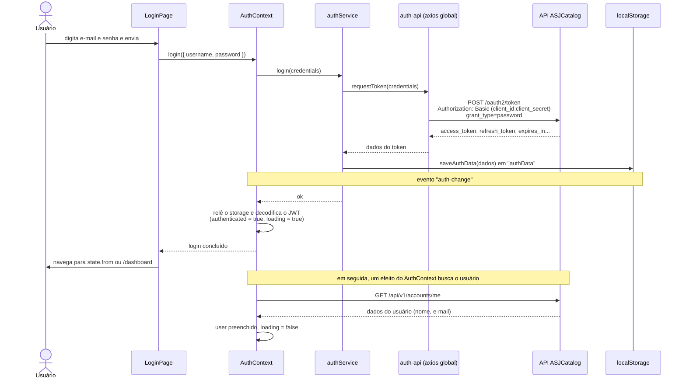
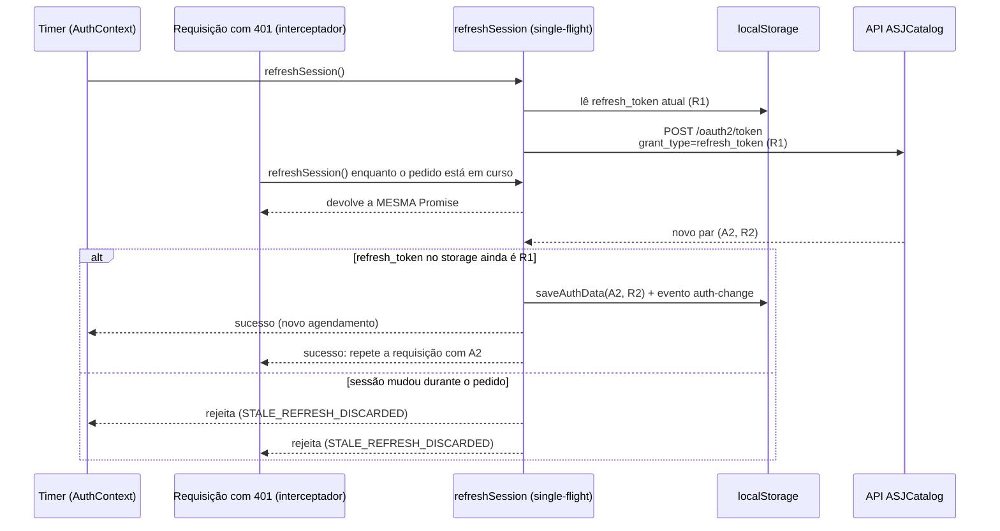

[← README](../README.md) · [Anterior](API-AND-SERVICES.md) · [Próximo](ERROR-HANDLING.md)

# Autenticação

Este documento explica como o usuário entra, permanece logado e sai do ASJCatalog. Você vai entender o modelo OAuth2 com tokens JWT usado pela API, o fluxo de login passo a passo, onde e como a sessão é guardada, como o frontend lê o token, como a sessão é renovada sem o usuário perceber e o que acontece no logout. No fim, há um resumo dos riscos desse modelo.

## Onde fica no código

| Arquivo | Papel |
| --- | --- |
| `frontend/src/api/auth-api.ts` | Pede o token (login) e renova a sessão (`refreshSession`) |
| `frontend/src/services/auth-service.ts` | `login`, `logout`, `isAuthenticated`, `getCurrentUser` |
| `frontend/src/contexts/AuthContext.tsx` | Estado da sessão para toda a aplicação e renovação agendada |
| `frontend/src/api/axios.ts` | Renovação ao receber 401 e encerramento da sessão |
| `frontend/src/utils/storage.ts` | Lê, grava e apaga a sessão no `localStorage` |
| `frontend/src/utils/permissions.ts` | Decodifica o token (`decodeToken`) e verifica a expiração (`isTokenValid`) |
| `frontend/src/utils/constants.ts` | `TOKEN_KEY`, `TOKEN_REFRESH_SKEW_MS`, `CLIENT_ID`, `CLIENT_SECRET` |
| `frontend/src/types/auth.ts` | Tipos `LoginResponse`, `JwtPayload`, `Role`, `AuthContextData` |
| `frontend/src/pages/auth/LoginPage.tsx` | Tela de login |
| `frontend/src/hooks/useAuth.ts`, `frontend/src/hooks/useRoles.ts` | Acesso à sessão e aos perfis dentro dos componentes |

## O modelo: OAuth2, password grant e JWT

**OAuth2** é um protocolo de autorização. Nele, quem quer acessar a API pede um **token** a um servidor de autorização e depois apresenta esse token em cada requisição. A API do ASJCatalog funciona assim.

A forma de pedir o token chama-se ***grant type*** (tipo de concessão). O frontend usa o **password grant**: ele envia o e-mail e a senha digitados pelo usuário diretamente ao endpoint `/oauth2/token`. Junto, envia as credenciais do próprio aplicativo cliente (`client_id` e `client_secret`) no formato **Basic**.

A API responde com dois tokens:

| Token | Para que serve | Formato |
| --- | --- | --- |
| **Access token** (token de acesso) | Vai em toda requisição, no cabeçalho `Authorization: Bearer <token>`. Tem validade curta | **JWT** |
| **Refresh token** (token de renovação) | Serve só para pedir um novo par de tokens quando o access token está perto de expirar | Opaco: um texto sem significado para o frontend |

**JWT** (*JSON Web Token*) é um token em três partes separadas por pontos: `cabeçalho.payload.assinatura`, cada uma codificada em Base64. Exemplo fictício e encurtado: `eyJhbGciOi...eyJzdWIiOi...SflKxwRJ...`. O **payload** é um JSON com informações chamadas **claims** (por exemplo, quem é o usuário e quando o token expira).

O frontend **lê** o payload para saber quem está logado, mas **não verifica a assinatura**. Quem confere se o token é autêntico é a API, a cada requisição.

## Fluxo de login



1. **Tela:** a `LoginPage` valida o formulário (e-mail e senha obrigatórios) e chama `login` do `AuthContext`, obtido com o hook `useAuth`.
2. **Service:** `authService.login` chama `requestToken` e, se der certo, grava a resposta com `saveAuthData`.
3. **Pedido de token:** `requestToken` monta o corpo no formato `application/x-www-form-urlencoded` e envia com o cabeçalho Basic:

   `frontend/src/api/auth-api.ts`

   ```ts
   export async function requestToken({ username, password }: LoginRequest): Promise<LoginResponse> {
     const body = qs.stringify({
       username,
       password,
       grant_type: "password",
     });

     const res = await axios.post<LoginResponse>(buildAuthUrl(ENDPOINTS.token), body, {
       headers: { Authorization: basicAuthHeader(), ...FORM_HEADERS },
     });
     return res.data;
   }
   ```

   Ele usa o `axios` **global**, e não a instância `http`. Assim, o pedido de token não passa pelo interceptador de 401, o que evita um ciclo "renovar → 401 → renovar".
4. **Armazenamento:** `saveAuthData` grava os dados no `localStorage` e dispara o evento `auth-change` (detalhes na próxima seção).
5. **Estado:** o `AuthContext` relê o storage, decodifica o token e passa a considerar o usuário autenticado, com `loading = true`. O `login` termina aqui, sem esperar os dados do usuário.
6. **Redirecionamento:** a `LoginPage` navega para o caminho guardado pelo `PrivateRoute` em `state.from` ou, se não houver, para `/dashboard`. Veja [ROUTES-AND-PAGES.md](ROUTES-AND-PAGES.md#privateroute).
7. **Dados do usuário:** um efeito do `AuthContext` busca `GET /api/v1/accounts/me`. Até a resposta chegar, `loading` continua `true`, e o `PrivateRoute` mostra a tela de carregamento. Se essa busca falhar, a sessão continua válida, mas sem nome e e-mail (`user` fica `null`).

Se o login falhar, a tela trata três casos de forma especial: conta inativa (`ACCESS_DISABLED`), credenciais inválidas (`invalid_grant`) e falha de rede. Os detalhes estão em [ERROR-HANDLING.md](ERROR-HANDLING.md#erros-no-login).

O papel do `AuthContext` aqui é guardar o estado da sessão e disponibilizá-lo para toda a aplicação. O funcionamento interno dele será detalhado em `CONTEXTS.md` (próximo lote).

## Onde a sessão fica guardada

A sessão é gravada no **`localStorage`** do navegador, na chave **`authData`** (constante `TOKEN_KEY`), como um texto JSON. A estrutura segue o tipo `LoginResponse`:

| Campo | Tipo | Conteúdo |
| --- | --- | --- |
| `access_token` | `string` | O JWT usado nas requisições |
| `refresh_token` | `string` | O token opaco de renovação |
| `token_type` | `string` | Tipo do token informado pela API |
| `expires_in` | `number` | Validade do access token, em segundos, informada pela API |
| `scope` | `string` | Escopos concedidos pela API |

`frontend/src/utils/storage.ts`

```ts
export function saveAuthData(data: LoginResponse): void {
  if (typeof window === "undefined") return;
  window.localStorage.setItem(TOKEN_KEY, JSON.stringify(data));
  // Uma nova sessão invalida qualquer e-mail pendente de ativação.
  window.localStorage.removeItem(PENDING_EMAIL_KEY);
  window.dispatchEvent(new Event("auth-change"));
}
```

- O evento **`auth-change`** avisa o `AuthContext`, na mesma aba, que a sessão mudou.
- O `AuthContext` também escuta o evento **`storage`**, que o navegador dispara quando **outra aba** altera o `localStorage`. Assim, login e logout feitos numa aba se refletem nas outras.
- O campo `expires_in` é gravado, mas o frontend não o usa: a expiração é lida do próprio token (claim `exp`).

## Leitura do token (jwt-decode)

A biblioteca **jwt-decode** transforma o payload do access token num objeto. Isso é feito em `decodeToken`, e `isTokenValid` usa o resultado para verificar a expiração:

`frontend/src/utils/permissions.ts`

```ts
export function decodeToken(): JwtPayload | null {
  const data = getAuthData();
  if (!data?.access_token) return null;
  try {
    return jwtDecode<JwtPayload>(data.access_token);
  } catch {
    return null;
  }
}

export function isTokenValid(): boolean {
  const decoded = decodeToken();
  if (!decoded?.exp) return false;
  return Date.now() < decoded.exp * 1000;
}
```

Claims do payload usados pelo frontend (tipo `JwtPayload` em `types/auth.ts`):

| Claim | Tipo | Uso no frontend |
| --- | --- | --- |
| `exp` | `number` | Momento de expiração, em segundos desde 1970. Multiplicado por 1000 para comparar com `Date.now()` (milissegundos). Define quando renovar a sessão |
| `authorities` | `Role[]` | Perfis do usuário: `ROLE_ADMIN` e/ou `ROLE_OPERATOR`. Viram `roles` no `AuthContext` |
| `userId` | `number` | Identificador do usuário. Vira `userId` no `AuthContext` |
| `username` | `string` | Login (e-mail) do usuário. Vira `username` no `AuthContext` |

O tipo também declara `sub`, `aud`, `iss`, `iat`, `nbf` e `jti`, que o frontend não usa. Segundo o comentário em `types/auth.ts`, `sub` e `aud` identificam o **aplicativo cliente**, não o usuário.

- Nome e e-mail exibidos na interface **não** vêm do token: vêm de `GET /api/v1/accounts/me`.
- O **refresh token nunca é decodificado**: para o frontend, ele é só um texto a ser devolvido à API.

### Quando a sessão é considerada ativa

O `AuthContext` considera o usuário autenticado quando há um access token legível **e** uma destas condições vale:

- o access token ainda não expirou; **ou**
- existe um refresh token salvo, mesmo que o access token já tenha expirado (a renovação cuidará disso).

## Renovação da sessão (refresh)

O access token expira. Para o usuário não ser deslogado no meio do trabalho, o frontend troca o par de tokens usando o refresh token. Isso acontece em dois momentos:

| Momento | Quem dispara | Quando |
| --- | --- | --- |
| **Proativo** | `AuthContext` | Um `setTimeout` agendado para **60 segundos antes** do `exp` (`TOKEN_REFRESH_SKEW_MS = 60_000`). Também ao voltar para a aba (`visibilitychange`), se esse momento já tiver passado |
| **Reativo** | Interceptador de resposta (`api/axios.ts`) | Quando uma requisição recebe **401** e há refresh token salvo. Depois de renovar, a requisição original é repetida uma vez |

Nos dois casos, a renovação é um `POST /oauth2/token` com `grant_type=refresh_token`, o mesmo cabeçalho Basic e o `axios` global.

A API usa **rotação** de refresh token: cada renovação devolve um par **novo**, e o refresh token anterior deixa de valer. Por isso, a ordem das renovações importa, e o frontend toma dois cuidados.

### Uma renovação por vez (single-flight)

Se o timer e várias requisições com 401 pedissem renovação ao mesmo tempo, cada pedido usaria o mesmo refresh token e só o primeiro funcionaria. Para evitar isso, `refreshSession` guarda a Promise em andamento numa variável do módulo: quem chama enquanto uma renovação está em curso recebe **a mesma Promise**. Esse padrão chama-se **single-flight**.

`frontend/src/api/auth-api.ts`

```ts
export function refreshSession(): Promise<LoginResponse> {
  if (refreshPromise) return refreshPromise;

  const current = getAuthData()?.refresh_token;
  if (!current) return Promise.reject(new Error("NO_REFRESH_TOKEN"));

  refreshPromise = refreshTokenRequest(current)
    .then((data) => {
      ...
      if (getAuthData()?.refresh_token !== current) {
        throw new Error("STALE_REFRESH_DISCARDED");
      }
      saveAuthData(next);
      return next;
    })
    .finally(() => {
      refreshPromise = null;
    });
```

*(Trecho resumido: os `...` indicam linhas omitidas.)*

O single-flight vale **dentro de uma aba**: cada aba tem sua própria variável `refreshPromise`.

### Descarte de resultados de sessões já substituídas (compare-and-swap)

Antes de gravar o par novo, `refreshSession` confere se o refresh token no `localStorage` ainda é o mesmo que originou o pedido. Se não for, significa que, enquanto a resposta chegava, a sessão mudou: houve logout, um novo login ou outra aba já renovou. Nesse caso, o resultado tardio é **descartado** (`STALE_REFRESH_DISCARDED`) em vez de sobrescrever a sessão atual. Essa técnica de "só grava se o valor ainda for o esperado" chama-se **compare-and-swap**.

Outros cuidados de `refreshSession`:

- Uma resposta sem `access_token` é tratada como falha (`INVALID_REFRESH_RESPONSE`).
- Se a resposta vier sem `refresh_token`, o atual é mantido.

### Quando a renovação falha

- **No interceptador (reativo):** a sessão só é encerrada se o refresh token salvo ainda for o mesmo do início da tentativa. Ao encerrar, o interceptador apaga a sessão e, se o usuário estiver numa página privada, recarrega a aplicação em `/auth/login`.
- **No `AuthContext` (proativo):** qualquer falha encerra a sessão (logout local), a menos que o agendamento já tenha sido cancelado porque a sessão mudou. Sem sessão, o `PrivateRoute` manda o usuário ao login.
- **Sem refresh token:** quando o access token expira, a sessão é encerrada.



## Logout

O logout é feito pelo botão "Sair" da `Navbar`, que chama `logout` do `AuthContext` e navega para `/`. Por baixo, `authService.logout` chama `removeAuthData`:

`frontend/src/utils/storage.ts`

```ts
export function removeAuthData(): void {
  if (typeof window === "undefined") return;
  window.localStorage.removeItem(TOKEN_KEY);
  window.localStorage.removeItem(PENDING_EMAIL_KEY);
  window.dispatchEvent(new Event("auth-change"));
}
```

| É apagado | Continua no navegador |
| --- | --- |
| `authData` (os dois tokens) | `asj.lang` (idioma) e `asj.theme` (tema) |
| `pendingActivationEmail` (e-mail aguardando ativação) | `activationResendAvailableAt` (espera para reenviar o e-mail de ativação) |

O logout acontece **somente no navegador**: o frontend não avisa a API. Os tokens apagados continuam existindo do lado da API até expirarem, a menos que a API tenha outro mecanismo que o frontend não usa.

Além do botão, a sessão também é encerrada automaticamente quando a renovação falha (seção anterior).

## Perfis: ROLE_ADMIN e ROLE_OPERATOR

Os perfis vêm do claim `authorities` do access token. O hook `useRoles` oferece `hasRole`, `hasAnyRole` e `isAdmin` para verificá-los.

| Onde o perfil é verificado | Como |
| --- | --- |
| Rotas `/dashboard/users/*` | `RoleRoute` exige `ROLE_ADMIN` (veja [ROUTES-AND-PAGES.md](ROUTES-AND-PAGES.md#proteções-de-rota)) |
| Botões de criar e editar produto e categoria | Componente `Authorization` com `ROLE_OPERATOR` ou `ROLE_ADMIN` |
| Botões de excluir produto, categoria e usuário | Componente `Authorization` com `ROLE_ADMIN` |
| Item "Usuários" do menu lateral | `Sidebar` mostra só se `isAdmin` |
| Total de usuários e atalho "novo usuário" no dashboard | `DashboardPage` mostra só se `isAdmin` |
| Rótulo do perfil na barra superior | `Navbar` mostra "administrador" se `isAdmin` e "operador" nos demais casos |

Essas verificações só **escondem** telas e botões. Quem impede de fato uma ação sem permissão é a API, que responde **403** (proibido).

## Cuidados e limitações

- **Tokens no `localStorage`:** o access token e o refresh token ficam num armazenamento que qualquer JavaScript da página consegue ler. Se o site sofrer um ataque de **XSS** (*Cross-Site Scripting*, injeção de script malicioso na página), o atacante pode copiar os tokens. Com o refresh token, ele consegue renovar a sessão e mantê-la ativa por muito tempo. Alternativas comuns guardam a sessão em cookies `HttpOnly`, inacessíveis ao JavaScript, mas exigem mudanças na API.
- **`client_secret` no bundle:** numa SPA, tudo o que vai para o navegador é público. O `VITE_CLIENT_SECRET` fica dentro do JavaScript e pode ser lido por qualquer pessoa, então ele **não protege nada** de verdade. Por isso, o OAuth trata aplicações que rodam no navegador como **clientes públicos**, que não conseguem guardar segredos.
- **Logout só local:** o frontend não pede à API para invalidar os tokens. Um token copiado antes do logout continua funcionando até expirar.
- **Password grant é legado:** as recomendações atuais de segurança do OAuth 2.0 (**RFC 9700**, *Best Current Practice for OAuth 2.0 Security*, de janeiro de 2025) dizem que o password grant **não deve** ser usado. Um dos motivos é que a aplicação manipula diretamente a senha do usuário. Para SPAs, a recomendação é o fluxo *Authorization Code* com **PKCE**. Mudar de fluxo envolve frontend e backend.
- **Renovação proativa sem a checagem do interceptador:** quando a renovação agendada falha, o `AuthContext` encerra a sessão sem conferir se ela já foi substituída, como o interceptador faz. A falha também pode ser um `STALE_REFRESH_DISCARDED` (outra aba renovou antes). Nesse caso, o encerramento só não acontece se o agendamento já tiver sido cancelado pela atualização de estado (evento `storage`). Não está claro no código se isso é sempre garantido com várias abas abertas.
- **Single-flight por aba:** abas diferentes podem pedir renovação ao mesmo tempo com o mesmo refresh token. O compare-and-swap evita que uma resposta tardia sobrescreva a sessão, mas um dos pedidos pode falhar na API por causa da rotação.

## Veja também

- [API-AND-SERVICES.md](API-AND-SERVICES.md): instância `http`, interceptadores e endpoints.
- [ERROR-HANDLING.md](ERROR-HANDLING.md): como os erros de login e de sessão chegam à tela.
- [ROUTES-AND-PAGES.md](ROUTES-AND-PAGES.md): `PrivateRoute`, `RoleRoute` e redirecionamento após o login.
- [ENVIRONMENT-AND-SETUP.md](ENVIRONMENT-AND-SETUP.md): variáveis `VITE_CLIENT_ID` e `VITE_CLIENT_SECRET`.
- [GLOSSARY.md](GLOSSARY.md): significado dos termos técnicos usados aqui.
