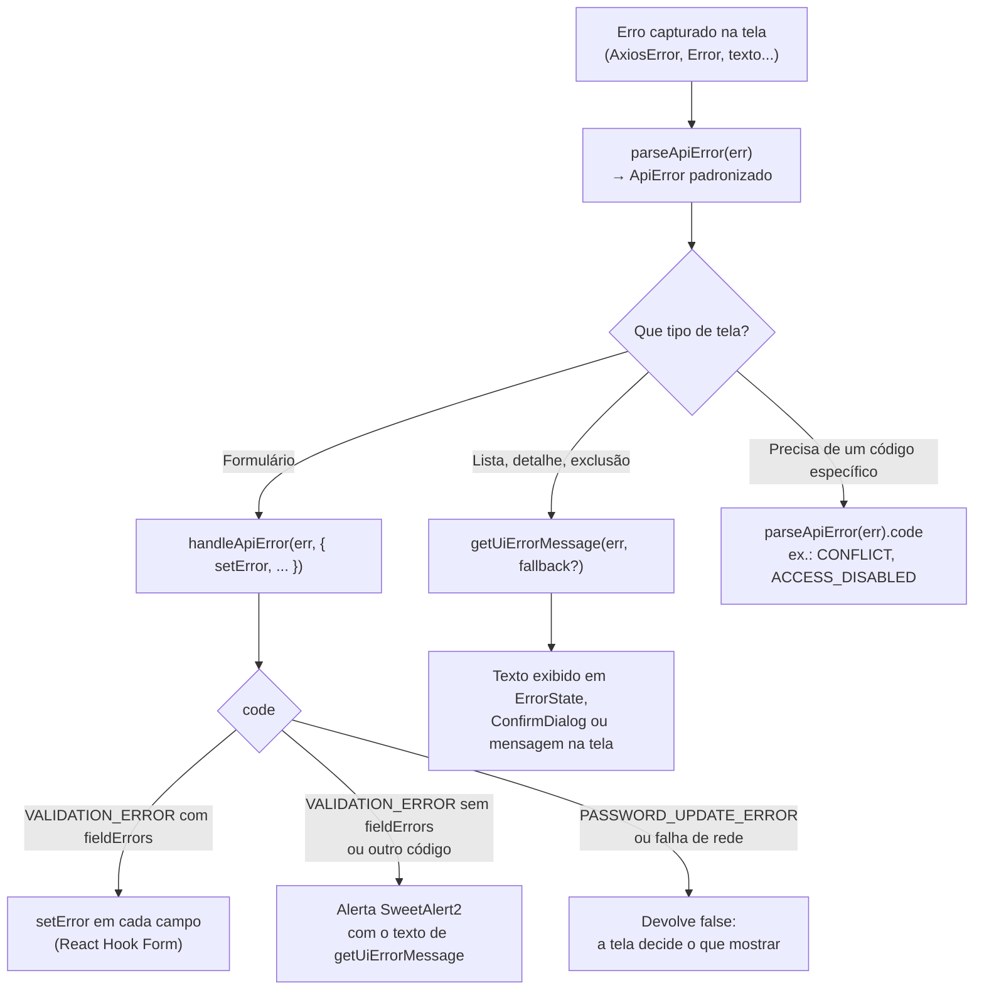

[← README](../README.md) · [Anterior](AUTHENTICATION.md) · [Próximo](CONTEXTS.md)

# Tratamento de erros

Este documento mostra o que acontece quando uma requisição dá errado. Você vai ver como o frontend transforma qualquer erro num formato único, como decide entre mostrar o erro no campo do formulário, num alerta ou na própria tela, como cada situação (rede, validação, 401, 403, 404, 409, 500…) é tratada e como seguir o mesmo padrão numa tela nova.

## Onde fica no código

| Arquivo | Papel |
| --- | --- |
| `frontend/src/utils/api-error.ts` | `parseApiError`: converte qualquer erro num objeto `ApiError` padronizado. Também define o tipo `ApiErrorCode` |
| `frontend/src/utils/api-error-handler.ts` | `handleApiError`: decide o que fazer com o erro num formulário. `getApiErrorCode`: atalho para obter só o código |
| `frontend/src/utils/ui-error.ts` | `getUiErrorMessage`: texto seguro para exibir. `isNotFoundError`: identifica o 404 |
| `frontend/src/utils/alerts.ts` | Alertas em janela (SweetAlert2) |
| `frontend/src/hooks/usePagedQuery.ts`, `frontend/src/hooks/useResource.ts` | Hooks de carregamento que já convertem erros em mensagem |
| `frontend/src/components/shared/ErrorState.tsx`, `NotFoundState.tsx`, `ConfirmDialog.tsx` | Componentes que exibem o erro na tela |
| `frontend/src/i18n/locales/*/common.json` | Textos genéricos de erro (`errors.title`, `errors.generic`, `errors.network`) |

## O caminho de um erro

Quando o Axios recebe uma resposta de erro (ou nenhuma resposta), ele rejeita a Promise com um `AxiosError`. A tela captura esse erro com `try/catch` (ou `.catch`) e usa três funções, cada uma com um papel:

| Função | Papel | Tem efeitos visíveis? |
| --- | --- | --- |
| `parseApiError(err)` | **Interpretar**: transforma o erro bruto num `ApiError` | Não (é uma **função pura**) |
| `getUiErrorMessage(err, fallback?)` | **Escolher o texto** que pode aparecer para o usuário | Não |
| `handleApiError(err, options)` | **Agir**: marca os campos do formulário ou abre um alerta | Sim |

`handleApiError` e `getUiErrorMessage` usam `parseApiError` internamente. Por isso, só `api-error.ts` precisa conhecer o formato do erro da API.



## O contrato de erro da API

O frontend espera que a API devolva erros com este formato. Ele foi descrito a partir dos tipos de `api-error.ts`; o exemplo abaixo é **ilustrativo**:

```json
{
  "timestamp": "2026-01-01T12:00:00Z",
  "status": 400,
  "code": "VALIDATION_ERROR",
  "error": "Erro de validação",
  "message": "Verifique os campos informados.",
  "path": "/api/v1/products",
  "fieldErrors": [{ "fieldName": "name", "message": "O nome é obrigatório." }]
}
```

Os códigos que o frontend reconhece (`ApiErrorCode`):

`frontend/src/utils/api-error.ts`

```ts
export type ApiErrorCode =
  | "VALIDATION_ERROR"
  | "PASSWORD_UPDATE_ERROR"
  | "RESOURCE_NOT_FOUND"
  | "DATABASE_ERROR"
  | "CONFLICT"
  | "INVALID_TOKEN"
  | "ACCESS_DISABLED"
  | "ACCESS_DENIED"
  | "AUTHENTICATION_REQUIRED"
  | "INTERNAL_SERVER_ERROR";
```

Um `code` fora dessa lista vira `null`, ou seja, o erro é tratado como "fora do contrato".

### O objeto `ApiError`

`parseApiError` sempre devolve um `ApiError`, inclusive para falhas de rede:

| Campo | Tipo | Significado |
| --- | --- | --- |
| `status` | `number` | Código HTTP. `0` quando não houve resposta |
| `code` | `ApiErrorCode \| null` | Código do contrato, ou `null` se não reconhecido |
| `message` | `string` | Mensagem da API, já traduzida por ela. Nunca vazio (há um texto padrão) |
| `error` | `string \| null` | Título/categoria do erro enviado pela API |
| `fieldErrors` | `{ fieldName, message }[]` | Erros por campo. Sempre um array, que pode ser vazio |
| `isNetworkError` | `boolean` | `true` quando a requisição não teve resposta (rede fora, servidor desligado, CORS bloqueado) |
| `timestamp`, `path` | `string \| null` | Momento e caminho da requisição, quando enviados |

Regras de `parseApiError`:

- **Erro do Axios sem resposta:** `isNetworkError: true`, `status: 0`.
- **Erro do Axios com resposta:** lê os campos do corpo da resposta, um a um, aceitando só valores do tipo esperado.
- **`Error` comum ou texto:** usa a mensagem do erro.
- **Qualquer outra coisa:** usa uma mensagem genérica.

## O texto mostrado ao usuário: `getUiErrorMessage`

Esta função garante que o usuário nunca veja mensagens técnicas, como "Network Error" ou "Request failed with status code 500":

`frontend/src/utils/ui-error.ts`

```ts
export function getUiErrorMessage(err: unknown, fallback?: string): string {
  const parsed = parseApiError(err);
  if (parsed.isNetworkError) return i18n.t("common:errors.network");
  if (parsed.code) return parsed.message;
  return fallback ?? i18n.t("common:errors.generic");
}
```

1. **Falha de rede:** texto traduzido de "falha de conexão".
2. **Erro dentro do contrato** (`code` reconhecido): a mensagem enviada pela API.
3. **Qualquer outro caso:** o `fallback` informado pela tela ou, se não houver, o texto genérico traduzido.

## Formulários: `handleApiError` e React Hook Form

Os formulários usam o **React Hook Form** (biblioteca de formulários). Quando o envio falha, a tela chama `handleApiError`, passando a função `setError` do formulário:

`frontend/src/utils/api-error-handler.ts`

```ts
  switch (parsed.code) {
    case "PASSWORD_UPDATE_ERROR": {
      ...
      return false;
    }
    case "VALIDATION_ERROR": {
      if (options.setError && parsed.fieldErrors.length > 0) {
        let focused = false;
        for (const fe of parsed.fieldErrors) {
          if (!fe.fieldName) continue;
          options.setError(
            fe.fieldName,
            { type: "server", message: fe.message },
            focused ? undefined : { shouldFocus: true },
          );
          focused = true;
        }
        return true;
      }
      await alerts.error(options.validationTitle ?? title, message);
      return true;
    }
    default:
      await alerts.error(title, message);
      return true;
  }
```

*(Trecho resumido: os `...` indicam linhas omitidas. Antes do `switch`, a função devolve `false` se o erro for de rede.)*

| Situação | O que `handleApiError` faz | Retorno |
| --- | --- | --- |
| Falha de rede | Nada | `false` |
| `PASSWORD_UPDATE_ERROR` | Nada (a tela trata) | `false` |
| `VALIDATION_ERROR` com `fieldErrors` | Marca cada campo com `setError` e coloca o foco no primeiro | `true` |
| `VALIDATION_ERROR` sem `fieldErrors` | Alerta com `validationTitle` (ou o título padrão) e a mensagem | `true` |
| Qualquer outro erro | Alerta com `fallbackTitle` (ou "Erro") e o texto de `getUiErrorMessage` | `true` |

**Como o erro chega ao campo:** o `fieldName` enviado pela API precisa ter **exatamente** o mesmo nome do campo registrado no formulário (`register("name")`, `register("email")`…). O `setError` marca esse campo com `type: "server"`, e o componente `Input` mostra a mensagem logo abaixo dele.

**O retorno importa:** `false` significa "não mostrei nada". A tela então exibe o erro do seu jeito, em geral com `getUiErrorMessage`. Exemplo do cadastro:

`frontend/src/pages/auth/RegisterPage.tsx`

```tsx
      const handled = await handleApiError(err, {
        setError: (name, error) => setError(name as keyof RegisterFormFields, error),
        fallbackTitle: t("auth:register.failTitle"),
        fallbackMessage: t("auth:register.failMessage"),
      });
      if (!handled)
        await alerts.error(
          t("auth:register.failTitle"),
          getUiErrorMessage(err, t("auth:register.failMessage")),
        );
```

### Quando o SweetAlert2 é usado

O **SweetAlert2** abre uma janela de alerta sobre a página. Ele é sempre chamado por meio de `utils/alerts.ts`, nunca diretamente. No tratamento de erros, aparece em:

- `handleApiError`, nos casos da tabela acima que devolvem `true` sem marcar campos;
- telas de autenticação, para erros de rede ou casos sem campo (por exemplo, cadastro, recuperação e redefinição de senha, e o reenvio do e-mail de ativação).

Nos demais casos, o erro aparece **na própria tela**, sem janela:

| Onde | Como o erro aparece |
| --- | --- |
| Listas do dashboard (`usePagedQuery`) e telas de detalhe ou edição (`useResource`) | `ErrorState`, com botão "Tentar novamente" |
| Exclusão em lista | Mensagem dentro do `ConfirmDialog` (prop `error`) |
| Formulários de produto, categoria e usuário (quando `handleApiError` devolve `false`) | Parágrafo de erro acima dos botões |
| Perfil (dados pessoais e senha) | Caixa de aviso dentro do formulário |

## Como cada situação é tratada

O frontend decide quase sempre pelo **`code`** do contrato, e não pelo número do status HTTP. Os números aparecem no código apenas nos casos indicados.

| Situação | Como o frontend reconhece | Tratamento |
| --- | --- | --- |
| **Falha de rede** (sem resposta, inclusive bloqueio de CORS) | `isNetworkError` | Texto "falha de conexão" (`common:errors.network`). Em formulários, `handleApiError` devolve `false`, e a tela mostra esse texto em alerta ou na tela. **Exceção:** o catálogo público mostra o erro genérico, sem a mensagem de conexão |
| **Validação** | `code: "VALIDATION_ERROR"` (o status 400 não é verificado no código) | Erros por campo no formulário ou alerta. Na ativação de conta, vira o estado "link inválido" |
| **Erro de negócio na troca de senha** (HTTP 422, segundo comentário no código) | `code: "PASSWORD_UPDATE_ERROR"` | A tela de segurança mostra a mensagem da API no campo "senha atual" e numa caixa de aviso, sem alerta e sem afetar a sessão |
| **401** (não autorizado) | Status 401 no interceptador do Axios | Tenta renovar a sessão e repetir a requisição. Se não der, encerra a sessão (veja [AUTHENTICATION.md](AUTHENTICATION.md#quando-a-renovação-falha)). Um 401 com token válido segue para a tela como erro comum |
| **Token de ativação inválido ou expirado** | `code: "INVALID_TOKEN"` | Na ativação de conta, estado "link expirado", com opção de reenviar |
| **Conta inativa no login** | `code: "ACCESS_DISABLED"` | Mensagem no formulário de login e cartão com opção de reenviar a ativação |
| **403** (sem permissão) | Nenhum tratamento específico (`ACCESS_DENIED` cai no caso geral) | Alerta (formulários) ou `ErrorState` (listas e detalhes) com a mensagem da API |
| **404** (não encontrado) | Status 404, via `isNotFoundError` em `useResource` | Telas de detalhe e edição mostram `NotFoundState` ("não encontrado"), e não um erro. Na ativação de conta, `RESOURCE_NOT_FOUND` vira "link inválido" |
| **409** (conflito) | `code: "CONFLICT"` | Ao excluir uma categoria ainda usada por produtos, mensagem própria do frontend explicando o motivo. Na ativação, estado "conta já ativada". Nos demais casos, a mensagem da API |
| **429** (muitas requisições) | Status 429 | No reenvio do e-mail de ativação: alerta de aviso e, na tela de ativação pendente, o tempo de espera é reiniciado |
| **500 e outros 5xx** (erro no servidor) | Sem tratamento por status, exceto na tela de ativação pendente (`status >= 500`) | Mensagem da API, se vier no contrato (`INTERNAL_SERVER_ERROR`, `DATABASE_ERROR`), ou o texto genérico. Na ativação pendente, texto próprio de "serviço indisponível" |

### Erros no login

O endpoint de token (`/oauth2/token`) segue as regras do OAuth2, não o contrato de erro da aplicação. Por isso, a `LoginPage` verifica alguns casos antes de chamar `handleApiError`:

`frontend/src/pages/auth/LoginPage.tsx`

```tsx
      const code = getApiErrorCode(err);
      if (code === "ACCESS_DISABLED") {
        setInactiveAccount(true);
        setError("root", { message: t("auth:login.inactive.error") });
        return;
      }
      // OAuth2 password grant: credenciais inválidas retornam `error=invalid_grant`
      // sem o contrato próprio da aplicação (sem `code`/`message`), então
      // precisam ser reconhecidas aqui antes de cair no tratamento genérico.
      const parsed = parseApiError(err);
      if (parsed.error === "invalid_grant") {
        setError("root", { message: t("auth:login.invalid") });
        return;
      }
```

1. **Conta inativa** (`ACCESS_DISABLED`): mensagem no formulário e cartão com o botão de reenviar a ativação.
2. **Credenciais inválidas** (`error: "invalid_grant"`): mensagem traduzida pelo frontend, no formulário.
3. **Demais erros:** `handleApiError`. Se ele devolver `false` (rede), a tela mostra o texto no formulário e num alerta.

## Mensagens: quem traduz o quê

O interceptador envia o idioma ativo no cabeçalho `Accept-Language` em toda requisição da instância `http`, e a API devolve `message`, `error` e `fieldErrors[].message` **já traduzidos**. O frontend exibe esses textos como chegam, mas **só** quando o erro está dentro do contrato (`code` reconhecido).

| Quem traduz | Textos |
| --- | --- |
| **API** (via `Accept-Language`) | `message` dos erros do contrato e mensagens dos `fieldErrors` |
| **Frontend** (arquivos de `i18n/locales`) | Títulos dos alertas (`fallbackTitle`), texto genérico e de falha de conexão (`common:errors.*`), textos específicos de cada tela (credenciais inválidas, conta inativa, conflito ao excluir categoria, estados da ativação, limite de reenvio) e as validações feitas no próprio formulário antes do envio (campo obrigatório, e-mail inválido, regras de senha) |

Observações:

- O pedido de token usa o `axios` global, **sem** o interceptador. Por isso, não envia `Accept-Language`, e as mensagens de erro do login vindas da API não seguem o idioma escolhido. O frontend compensa nos casos que trata com textos próprios (credenciais inválidas e conta inativa).
- `parseApiError` tem dois textos padrão fixos em português, usados quando não há mensagem. Na interface, eles normalmente são substituídos pelos textos traduzidos de `getUiErrorMessage`.

## Como tratar erros numa tela nova

**Formulário que envia dados:**

```tsx
try {
  await algumService.salvar(dados);
} catch (err) {
  const handled = await handleApiError(err, {
    setError: (name, error) => setError(name as keyof MeusCampos, error),
    fallbackTitle: t("meuDominio:errors.saveTitle"),
    fallbackMessage: t("meuDominio:errors.saveMessage"),
  });
  if (!handled) setSaveError(getUiErrorMessage(err, t("meuDominio:errors.saveMessage")));
}
```

*(Exemplo de padrão: `algumService`, `MeusCampos` e as chaves `meuDominio:*` são nomes ilustrativos.)*

1. Use nos campos do formulário os **mesmos nomes** que a API usa nos `fieldErrors`. Caso contrário, o erro é gravado num campo que não existe na tela e não aparece.
2. Sempre trate o retorno `false` (falha de rede): mostre `getUiErrorMessage` na tela ou num alerta.

**Carregamento de dados:** use `useResource` (um item) ou `usePagedQuery` (lista). Eles já convertem o erro com `getUiErrorMessage` e separam o 404. Mostre o resultado com `ErrorState`, `NotFoundState` e o `reload`/`refetch` como ação de "tentar novamente".

**Ação pontual (excluir, reenviar):** use `getUiErrorMessage(err)` e mostre o texto perto da ação (por exemplo, na prop `error` do `ConfirmDialog`).

**Caso específico:** se a tela precisa reagir a um código, use `parseApiError(err).code` (ou `getApiErrorCode(err)`) e trate o caso antes do tratamento geral.

**Evite:**

- ler `err.response.data` diretamente: use `parseApiError`;
- mostrar `err.message` ao usuário: use `getUiErrorMessage`;
- importar `sweetalert2` diretamente: use `utils/alerts.ts`.

## Cuidados e limitações

- **Erro de campo que não aparece:** `handleApiError` grava cada `fieldErrors[].fieldName` no formulário sem verificar se o campo existe, e devolve `true`. Se o nome não coincidir, o usuário não vê nada. Exemplo: a tela de segurança registra o campo `password`, mas envia à API o campo `newPassword`. Um erro de validação devolvido para `newPassword` não seria exibido (comportamento deduzido do código; depende do nome que a API usa nos `fieldErrors`).
- **Catálogo sem mensagem de conexão:** o `CatalogPage` usa `parseApiError` diretamente e, numa falha de rede, mostra o erro genérico em vez de "falha de conexão".
- **Chave de tradução inexistente:** `CategoryForm` usa `common:error`, que não existe nos arquivos de tradução. O texto cai no padrão fixo "Erro", em português, em qualquer idioma.
- **Login sem `Accept-Language`:** mensagens de erro vindas do `/oauth2/token` não seguem o idioma escolhido.
- **403 sem tratamento próprio:** a falta de permissão aparece como um erro comum, com a mensagem da API.
- **Textos fixos em português** em `parseApiError` (padrões usados quando não há mensagem).

## Veja também

- [API-AND-SERVICES.md](API-AND-SERVICES.md): de onde vêm as requisições e o interceptador de 401.
- [AUTHENTICATION.md](AUTHENTICATION.md): o que acontece quando a sessão expira.
- [HOOKS.md](HOOKS.md): `usePagedQuery` e `useResource`, que já convertem erros em mensagem.
- [COMPONENTS.md](COMPONENTS.md): `ErrorState`, `NotFoundState`, `ConfirmDialog` e demais componentes de estado.
- [GLOSSARY.md](GLOSSARY.md): significado dos termos técnicos usados aqui.
