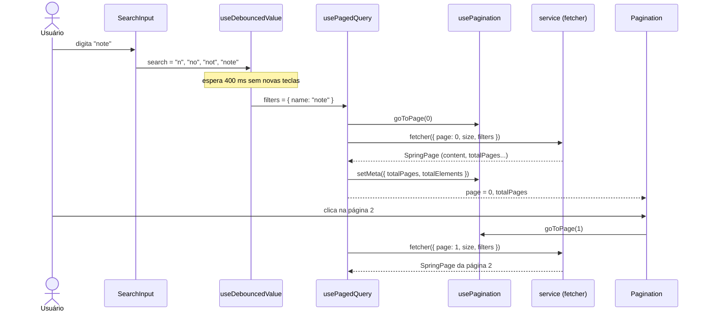

[← README](../README.md) · [Anterior](CONTEXTS.md) · [Próximo](COMPONENTS.md)

# Hooks

Este documento descreve os hooks customizados do projeto. Para cada um, você vai ver a assinatura real, os parâmetros, o retorno, um exemplo de uso tirado do código e os cuidados. No fim, há uma explicação de como `useDebouncedValue`, `usePagedQuery` e `usePagination` trabalham juntos numa listagem com busca e paginação.

## Onde fica no código

| Arquivo | Hook |
| --- | --- |
| `frontend/src/hooks/useAuth.ts` | `useAuth` |
| `frontend/src/hooks/useRoles.ts` | `useRoles` |
| `frontend/src/hooks/useTheme.ts` | `useTheme` |
| `frontend/src/hooks/useDebouncedValue.ts` | `useDebouncedValue` |
| `frontend/src/hooks/usePagination.ts` | `usePagination` |
| `frontend/src/hooks/usePagedQuery.ts` | `usePagedQuery` |
| `frontend/src/hooks/useResource.ts` | `useResource` |
| `frontend/src/i18n/hooks/useLanguage.ts` | `useLanguage` |
| `frontend/src/components/ProductShowcase/index.tsx` | `usePrefersReducedMotion` (local, não exportado) |

## O que é um hook customizado

Um **hook** é uma função do React cujo nome começa com `use` e que pode usar outros hooks (`useState`, `useEffect`, `useContext`…). Um **hook customizado** é um hook escrito pelo próprio projeto, que junta numa função lógica que várias telas repetiriam.

Regras do React que valem para todos eles:

- chame hooks só no **nível de cima** do componente (nunca dentro de `if`, `for` ou de funções internas);
- chame hooks só em **componentes** ou em **outros hooks**.

O código mostra três motivos para o projeto criar um hook:

| Motivo | Hooks |
| --- | --- |
| Ler um contexto com verificação de uso fora do provider | `useAuth`, `useTheme` |
| Derivar informação de um contexto | `useRoles` |
| Reaproveitar lógica de estado e efeitos entre telas | `useDebouncedValue`, `usePagination`, `usePagedQuery`, `useResource`, `useLanguage` |

## Resumo

| Hook | Finalidade | Onde é usado |
| --- | --- | --- |
| `useAuth` | Ler a sessão (`AuthContext`) | `PrivateRoute`, `RoleRoute`, `Navbar`, `LoginPage`, `DashboardPage`, `PersonalProfilePage`, `SecurityProfilePage`, `useRoles` |
| `useRoles` | Verificar perfis do usuário | `Authorization`, `Navbar`, `Sidebar`, `RoleRoute`, `DashboardPage` |
| `useTheme` | Ler e trocar o tema (`ThemeContext`) | `ThemeToggle` |
| `useDebouncedValue` | Atrasar a atualização de um valor (busca) | `ProductListPage`, `CategoryListPage`, `UserListPage` |
| `usePagination` | Guardar página, tamanho e totais | Só dentro de `usePagedQuery` |
| `usePagedQuery` | Buscar uma lista paginada com filtros | `ProductListPage`, `CategoryListPage`, `UserListPage` |
| `useResource` | Buscar um único registro (detalhe ou edição) | `ProductDetailsPage`, `ProductForm`, `CategoryForm`, `UserForm`, `UserDetailsPage` |
| `useLanguage` | Ler, listar e trocar o idioma | `LanguageSelector` |

---

## useAuth

Dá acesso ao `AuthContext`: sessão, perfis e ações de login e logout.

`frontend/src/hooks/useAuth.ts`

```ts
export function useAuth() {
  const ctx = useContext(AuthContext);
  if (!ctx) {
    throw new Error("useAuth deve ser usado dentro de <AuthProvider>");
  }
  return ctx;
}
```

- **Parâmetros:** nenhum.
- **Retorno:** o objeto `AuthContextData` (`authenticated`, `loading`, `user`, `userId`, `username`, `roles`, `login`, `logout`, `refreshUser`, `isAuthenticated`, `hasRole`). Cada campo está descrito em [CONTEXTS.md](CONTEXTS.md#o-que-o-contexto-expõe).

**Exemplo real:**

`frontend/src/routes/PrivateRoute.tsx`

```tsx
  const { authenticated, loading } = useAuth();
```

**Cuidados:**

- Lança um erro se usado fora do `AuthProvider`.
- Enquanto `loading` for `true`, `user` pode ser `null` mesmo com a sessão ativa. Trate esse caso antes de ler `user.firstName`.

## useRoles

Facilita as verificações de perfil a partir de `roles` do `useAuth`.

`frontend/src/hooks/useRoles.ts`

```ts
export function useRoles() {
  const { roles } = useAuth();

  const hasRole = (role: Role) => roles.includes(role);
  const hasAnyRole = (allowed: Role[]) =>
    allowed.length === 0 || allowed.some((r) => roles.includes(r));

  return {
    roles,
    hasRole,
    hasAnyRole,
    isAdmin: hasRole("ROLE_ADMIN"),
    isOperator: hasRole("ROLE_OPERATOR") || hasRole("ROLE_ADMIN"),
  };
}
```

- **Parâmetros:** nenhum.
- **Retorno:**

| Campo | Tipo | Significado |
| --- | --- | --- |
| `roles` | `Role[]` | Perfis do usuário |
| `hasRole(role)` | `(role: Role) => boolean` | Tem esse perfil? |
| `hasAnyRole(allowed)` | `(allowed: Role[]) => boolean` | Tem **algum** dos perfis? Lista vazia devolve `true` |
| `isAdmin` | `boolean` | Tem `ROLE_ADMIN` |
| `isOperator` | `boolean` | Tem `ROLE_OPERATOR` **ou** `ROLE_ADMIN` |

**Exemplo real:**

`frontend/src/components/Authorization/index.tsx`

```tsx
export default function Authorization({ roles, children, fallback = null }: AuthorizationProps) {
  const { hasAnyRole } = useRoles();
  return <>{hasAnyRole(roles) ? children : fallback}</>;
}
```

**Cuidados:**

- `isOperator` também é `true` para administradores, e nenhum componente o usa hoje.
- As verificações só escondem interface. A permissão real é decidida pela API (veja [AUTHENTICATION.md](AUTHENTICATION.md#perfis-role_admin-e-role_operator)).

## useTheme

Dá acesso ao `ThemeContext`.

`frontend/src/hooks/useTheme.ts`

```ts
export function useTheme() {
  const ctx = useContext(ThemeContext);
  if (!ctx) {
    throw new Error("useTheme deve ser usado dentro de <ThemeProvider>");
  }
  return ctx;
}
```

- **Parâmetros:** nenhum.
- **Retorno:** `{ theme, resolvedTheme, setTheme }` (veja [CONTEXTS.md](CONTEXTS.md#themecontext)).

**Exemplo real:**

`frontend/src/components/ThemeToggle/index.tsx`

```tsx
  const { theme, setTheme } = useTheme();
  const next = THEME_OPTIONS[(THEME_OPTIONS.indexOf(theme) + 1) % THEME_OPTIONS.length];
```

**Cuidados:** lança um erro se usado fora do `ThemeProvider`.

## useDebouncedValue

Devolve uma cópia do valor que só é atualizada depois de um tempo **sem novas mudanças**. Essa técnica se chama **debounce**. Ela evita uma requisição à API a cada tecla digitada na busca.

`frontend/src/hooks/useDebouncedValue.ts`

```ts
export function useDebouncedValue<T>(value: T, delay = 400): T {
  const [debounced, setDebounced] = useState(value);

  useEffect(() => {
    const id = setTimeout(() => setDebounced(value), delay);
    return () => clearTimeout(id);
  }, [value, delay]);

  return debounced;
}
```

- **Parâmetros:** `value` (qualquer tipo, por isso o genérico `<T>`) e `delay` em milissegundos (padrão `400`).
- **Retorno:** o valor "atrasado".
- **Como funciona:** a cada mudança de `value`, um timer é iniciado. Se `value` mudar antes do fim, o timer anterior é cancelado (`clearTimeout`) e outro começa.

**Exemplo real:**

`frontend/src/pages/dashboard/products/ProductListPage.tsx`

```tsx
  const [search, setSearch] = useState("");
  const [categoryId, setCategoryId] = useState("");
  const debouncedName = useDebouncedValue(search.trim(), 400);
```

O campo mostra `search` (atualizado a cada tecla), e a busca usa `debouncedName`.

**Cuidados:**

- No primeiro render, o valor devolvido é o próprio `value`, sem espera.
- A página do catálogo público (`CatalogPage`) não usa este hook: ela implementa o próprio debounce, com 350 ms.

## usePagination

Guarda o estado de paginação: página atual, tamanho da página e totais.

`frontend/src/hooks/usePagination.ts`

```ts
export function usePagination(initialSize = 12) {
  const [state, setState] = useState<PaginationState>({
    page: 0,
    size: initialSize,
    totalPages: 0,
    totalElements: 0,
  });
```

- **Parâmetros:** `initialSize`, o tamanho da página (padrão `12`).
- **Retorno:**

| Campo | Tipo | Significado |
| --- | --- | --- |
| `page` | `number` | Página atual, **começando em 0** (padrão do Spring) |
| `size` | `number` | Itens por página |
| `totalPages`, `totalElements` | `number` | Totais informados pela API |
| `goToPage(page)` | função | Troca a página |
| `setSize(size)` | função | Troca o tamanho e volta à página 0 |
| `setMeta({ totalPages, totalElements })` | função | Atualiza os totais |

**Uso:** nenhuma tela usa `usePagination` diretamente. Ele é a fonte do estado de página dentro de `usePagedQuery`, que o devolve no campo `pagination`.

**Cuidados:** `setSize` não é usado em nenhum lugar, e nenhuma tela permite trocar o tamanho da página.

## usePagedQuery

Busca uma lista paginada, reage a filtros e controla carregamento e erro. É o hook das listagens do dashboard.

`frontend/src/hooks/usePagedQuery.ts`

```ts
type Fetcher<T, F> = (args: { page: number; size: number; filters: F }) => Promise<SpringPage<T>>;

type Options<F> = {
  initialSize?: number;
  filters: F;
};

export function usePagedQuery<T, F extends object>(
  fetcher: Fetcher<T, F>,
  { initialSize = 12, filters }: Options<F>,
) {
```

- **Parâmetros:**
  - `fetcher`: função que recebe `{ page, size, filters }` e devolve uma `SpringPage<T>` (formato descrito em [API-AND-SERVICES.md](API-AND-SERVICES.md#respostas-paginadas-springpage));
  - `initialSize`: tamanho da página (padrão `12`);
  - `filters`: objeto com os filtros atuais, por exemplo `{ name, categoryId }`.
- **Retorno:**

| Campo | Tipo | Significado |
| --- | --- | --- |
| `data` | `T[]` | Itens da página atual |
| `isLoading` | `boolean` | Busca em andamento (começa `true`) |
| `error` | `string \| null` | Mensagem pronta para exibir (de `getUiErrorMessage`) |
| `pagination` | retorno de `usePagination` | `page`, `totalPages`, `goToPage`… |
| `refetch` | `() => Promise<void>` | Repete a busca atual (usado após excluir e em "tentar novamente") |

**Comportamentos:**

- **Filtros mudaram → volta à página 0.** O hook compara os filtros por `JSON.stringify`, então um objeto novo com os mesmos valores não conta como mudança.
- **Só a resposta mais recente vale.** Cada busca recebe um número; respostas de buscas mais antigas são ignoradas.
- **Página além do fim.** Se a página atual ficou vazia (por exemplo, depois de excluir o último item da última página), o hook volta para a última página existente.

**Exemplo real:**

`frontend/src/pages/dashboard/products/ProductListPage.tsx`

```tsx
  const fetcher = useCallback(
    ({
      page,
      size,
      filters,
    }: {
      page: number;
      size: number;
      filters: ProductFilters;
    }): Promise<Paginated<ProductResponse>> =>
      productService.findAll({
        page,
        size,
        name: filters.name || "",
        categoryIds: filters.categoryId || "0",
      }),
    [],
  );

  const { data, isLoading, error, pagination, refetch } = usePagedQuery<
    ProductResponse,
    ProductFilters
  >(fetcher, { initialSize: 10, filters });
```

**Cuidados:**

- **O `fetcher` precisa ser estável:** declare-o com `useCallback`. Uma função nova a cada render dispara uma nova busca a cada render.
- Enquanto busca, `isLoading` é `true`. As telas trocam a lista pelo `TableSkeleton`, então os dados anteriores somem durante a busca.
- O hook não diferencia 404 de outros erros: tudo vira `error`.
- Ao trocar um filtro estando numa página maior que 0, a ordem dos efeitos faz o hook disparar primeiro uma busca com a página antiga e os filtros novos e, em seguida, a busca da página 0. A primeira resposta é descartada, mas a requisição acontece.

## useResource

Busca **um** registro e diferencia quatro situações: carregando, encontrado, não existe (404) e erro.

`frontend/src/hooks/useResource.ts`

```ts
export type ResourceState<T> =
  | { status: "idle" }
  | { status: "loading" }
  | { status: "success"; data: T }
  | { status: "notFound" }
  | { status: "error"; message: string };

export function useResource<T>(fetcher: (() => Promise<T>) | null) {
```

- **Parâmetros:** `fetcher`, uma função sem argumentos que devolve uma Promise com o registro, **ou `null`** para não buscar nada (por exemplo, num formulário em modo de criação).
- **Retorno:** `{ state, reload }`.
  - `state`: um dos cinco estados acima. Com `fetcher` `null`, o estado é `idle`.
  - `reload()`: repete a busca (botão "tentar novamente").

**Exemplo real:**

`frontend/src/pages/catalog/ProductDetailsPage.tsx`

```tsx
  const id = Number(productId);
  const validId = Boolean(productId) && !Number.isNaN(id);
  const fetchProduct = useCallback(() => productService.findById(id), [id]);
  const { state, reload } = useResource(validId ? fetchProduct : null);

  if (state.status === "loading") {
    return <ProductDetailsSkeleton />;
  }
```

O `ProductForm` usa dois `useResource` ao mesmo tempo: um para as categorias e outro para o produto (só no modo de edição).

**Cuidados:**

- **O `fetcher` precisa ser estável** (`useCallback`), pelo mesmo motivo do `usePagedQuery`. Trocar o `fetcher`, por exemplo quando o `id` muda, inicia uma nova busca, e o resultado antigo nunca aparece para o registro novo.
- Não há cache: cada montagem da tela busca de novo.

## useLanguage

Fica em `frontend/src/i18n/hooks/`, e não em `hooks/`. Lê o idioma ativo, lista os idiomas disponíveis e troca o idioma.

`frontend/src/i18n/hooks/useLanguage.ts`

```ts
export function useLanguage() {
  const { i18n } = useTranslation();

  const current = (i18n.resolvedLanguage ?? i18n.language ?? DEFAULT_LANGUAGE) as SupportedLanguage;
```

- **Parâmetros:** nenhum.
- **Retorno:** `{ current, activeMeta, available, change }`. `current` é o código do idioma ativo (`pt-BR`, `en` ou `es`), `activeMeta` traz rótulo e bandeira, `available` é a lista de idiomas e `change(code)` troca o idioma.

**Exemplo real:**

`frontend/src/components/LanguageSelector/index.tsx`

```tsx
  const { current, activeMeta, available, change } = useLanguage();
```

Os detalhes de i18n estão em [INTERNATIONALIZATION.md](INTERNATIONALIZATION.md).

## Outros hooks

- **`usePrefersReducedMotion`**, dentro de `components/ProductShowcase/index.tsx`, informa se o usuário pediu ao sistema operacional para reduzir animações. O carrossel da página inicial usa isso para desligar a troca automática de slides. Ele não é exportado e só existe nesse arquivo.
- **`useTranslation`** (da biblioteca react-i18next) e os hooks do React Router (`useNavigate`, `useParams`, `useSearchParams`, `useLocation`) são usados em várias telas, mas não são do projeto.

## Listagem com busca e paginação: os três hooks juntos

As três listagens do dashboard (produtos, categorias e usuários) seguem o mesmo padrão:

1. O campo de busca (`SearchInput`) atualiza `search` a cada tecla.
2. `useDebouncedValue` produz `debouncedName` 400 ms depois da última tecla.
3. A tela monta `filters` com `useMemo` a partir de `debouncedName` (e da categoria, em produtos).
4. `usePagedQuery` percebe a mudança de `filters`, volta à página 0 e chama o `fetcher`.
5. O `fetcher` chama o service. A resposta atualiza `data` e, via `setMeta` do `usePagination`, os totais.
6. A tela mostra a lista e o componente `Pagination`, ligado a `pagination.page`, `pagination.totalPages` e `pagination.goToPage`.
7. Clicar numa página chama `goToPage`, o que muda `page` e dispara uma nova busca com os mesmos filtros.



A página exibida ao usuário começa em 1, mas o estado interno começa em 0. O componente `Pagination` faz a conversão (`p + 1`).

O catálogo público (`CatalogPage`) **não** usa esse padrão: ele tem debounce, paginação e controle de requisições próprios. Veja [COMPONENTS.md](COMPONENTS.md#cuidados-e-limitações).

## Cuidados e limitações

- **Funções estáveis:** `usePagedQuery` e `useResource` dependem de `fetcher` declarado com `useCallback`. Esquecer isso gera requisições em excesso.
- **Requisição extra ao filtrar fora da página 0:** consequência da ordem dos efeitos em `usePagedQuery` (descrita na seção do hook). ([#25](https://github.com/Albertinesilva/asjcatalog-frontend/issues/25))
- **Código sem uso:** `usePagination().setSize` e `useRoles().isOperator`. ([#24](https://github.com/Albertinesilva/asjcatalog-frontend/issues/24))
- **Hooks fora de `hooks/`:** `useLanguage` fica em `i18n/hooks/`, e `usePrefersReducedMotion` é local ao carrossel.
- **Catálogo fora do padrão:** a `CatalogPage` repete debounce, paginação e descarte de respostas antigas em vez de usar os hooks. ([#8](https://github.com/Albertinesilva/asjcatalog-frontend/issues/8))
- **Sem cache:** os hooks não guardam resultados entre telas; voltar a uma lista busca tudo de novo.

## Veja também

- [CONTEXTS.md](CONTEXTS.md): o que `useAuth` e `useTheme` leem.
- [API-AND-SERVICES.md](API-AND-SERVICES.md): os services chamados pelos `fetcher`s e o formato `SpringPage`.
- [ERROR-HANDLING.md](ERROR-HANDLING.md): de onde vem a mensagem em `error` e o tratamento do 404.
- [COMPONENTS.md](COMPONENTS.md): `SearchInput`, `Pagination` e os estados de carregamento e erro.
- [GLOSSARY.md](GLOSSARY.md): significado dos termos técnicos usados aqui.
