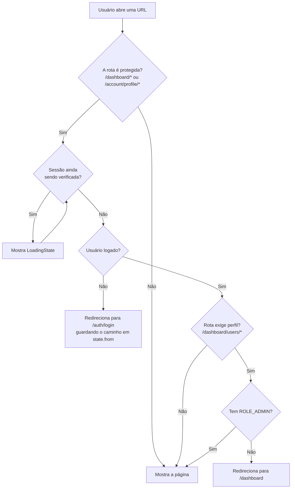

[← README](../README.md) · [Anterior](ENVIRONMENT-AND-SETUP.md) · [Próximo](API-AND-SERVICES.md)

# Rotas e páginas

Este documento explica como a URL do navegador vira uma tela. Você vai ver o mapa completo de rotas, os layouts que envolvem as páginas, como funcionam as proteções `PrivateRoute` e `RoleRoute`, quais rotas antigas de autenticação continuam ativas, como funciona a página 404 e quais telas são carregadas sob demanda.

## Onde fica no código

| Arquivo | Papel |
| --- | --- |
| `frontend/src/App.tsx` | Ativa o roteador (`BrowserRouter`) |
| `frontend/src/routes/AppRoutes.tsx` | Declara todas as rotas |
| `frontend/src/routes/PrivateRoute.tsx` | Proteção de autenticação (exige login) |
| `frontend/src/routes/RoleRoute.tsx` | Proteção de autorização (exige um perfil) |
| `frontend/src/routes/route-access.ts` | Lista de prefixos de URL privados |
| `frontend/src/layouts/` | `CatalogLayout`, `AuthLayout`, `DashboardLayout` |
| `frontend/src/pages/` | As telas |

## Visão geral

O roteamento usa o **React Router** (versão 6). Uma **rota** é a ligação entre um caminho de URL e o componente que deve aparecer.

As rotas são declaradas em `AppRoutes.tsx` de forma **aninhada**. Algumas rotas não têm `path`, só `element`: elas não correspondem a uma URL e servem para **envolver** as rotas filhas. É assim que o projeto aplica layouts e proteções. O componente pai mostra a rota filha no lugar onde coloca o `<Outlet />` (o "espaço reservado" para a rota filha).

`frontend/src/routes/AppRoutes.tsx`

```tsx
        <Route element={<PrivateRoute />}>
          <Route element={<DashboardLayout />}>
            <Route path="/dashboard" element={<DashboardPage />} />
            ...
            <Route element={<RoleRoute roles={["ROLE_ADMIN"]} redirectTo="/dashboard" />}>
              <Route path="/dashboard/users" element={<UserListPage />} />
              ...
            </Route>
          </Route>
        </Route>
```

*(Trecho resumido: os `...` indicam rotas omitidas.)*

Leia de fora para dentro. Para abrir `/dashboard/users`, o usuário precisa passar pelo `PrivateRoute` (estar logado), a tela é desenhada dentro do `DashboardLayout` e, por fim, o `RoleRoute` exige o perfil `ROLE_ADMIN`.

## Mapa completo de rotas

| Caminho | Página | Layout | Acesso | Perfil exigido |
| --- | --- | --- | --- | --- |
| `/` | `HomePage` | CatalogLayout | Pública | — |
| `/catalog` | `CatalogPage` | CatalogLayout | Pública | — |
| `/catalog/:productId` | `ProductDetailsPage` | CatalogLayout | Pública | — |
| `/auth/login` | `LoginPage` | AuthLayout | Pública | — |
| `/auth/register` | `RegisterPage` | AuthLayout | Pública | — |
| `/auth/recover` | `RecoverPage` | AuthLayout | Pública | — |
| `/auth/reset-password?token=…` | `ResetPasswordPage` | AuthLayout | Pública | — |
| `/auth/activation-pending` | `ActivationPendingPage` | AuthLayout | Pública | — |
| `/activate-account?token=…` | `ActivateAccountPage` | AuthLayout | Pública | — |
| `/dashboard` | `DashboardPage` | DashboardLayout | Protegida | Qualquer usuário logado |
| `/dashboard/products` | `ProductListPage` | DashboardLayout | Protegida | Qualquer usuário logado |
| `/dashboard/products/new` | `ProductForm` (modo criação) | DashboardLayout | Protegida | Qualquer usuário logado |
| `/dashboard/products/:id` | `ProductForm` (modo edição) | DashboardLayout | Protegida | Qualquer usuário logado |
| `/dashboard/categories` | `CategoryListPage` | DashboardLayout | Protegida | Qualquer usuário logado |
| `/dashboard/categories/new` | `CategoryForm` (modo criação) | DashboardLayout | Protegida | Qualquer usuário logado |
| `/dashboard/categories/:id` | `CategoryForm` (modo edição) | DashboardLayout | Protegida | Qualquer usuário logado |
| `/dashboard/users` | `UserListPage` | DashboardLayout | Protegida | `ROLE_ADMIN` |
| `/dashboard/users/new` | `UserForm` (modo criação) | DashboardLayout | Protegida | `ROLE_ADMIN` |
| `/dashboard/users/:id` | `UserDetailsPage` | DashboardLayout | Protegida | `ROLE_ADMIN` |
| `/dashboard/users/:id/edit` | `UserForm` (modo edição) | DashboardLayout | Protegida | `ROLE_ADMIN` |
| `/account/profile` | `ProfilePage` (página inicial do perfil) | DashboardLayout | Protegida | Qualquer usuário logado |
| `/account/profile/personal` | `PersonalProfilePage` | DashboardLayout | Protegida | Qualquer usuário logado |
| `/account/profile/security` | `SecurityProfilePage` | DashboardLayout | Protegida | Qualquer usuário logado |
| `*` (qualquer outro caminho) | `NotFoundPage` | Nenhum | Pública | — |

Observações sobre a tabela:

- Os caminhos alternativos `/login`, `/forgot-password`, `/reset-password` e `/activation-pending` também estão declarados e mostram as mesmas telas. Veja [Rotas antigas de autenticação](#rotas-antigas-de-autenticação).
- `:productId` e `:id` são **parâmetros de rota**: partes da URL que mudam, como o `7` em `/catalog/7`. A página lê esse valor com o hook `useParams`.
- `?token=…` é uma **query string**: dados depois do `?` na URL. As telas de ativação e de redefinição de senha leem o token com `useSearchParams`.
- Quando o parâmetro não é um número (por exemplo, `/catalog/abc`), as telas de detalhe e de edição mostram "não encontrado" **sem** chamar a API.
- Os perfis de acesso (*roles*) existentes são `ROLE_ADMIN` e `ROLE_OPERATOR` (`frontend/src/types/auth.ts`). Nenhuma rota exige `ROLE_OPERATOR` especificamente.
- Dentro das telas protegidas, alguns botões dependem do perfil: por exemplo, excluir produtos, categorias e usuários aparece só para `ROLE_ADMIN`. Isso é feito pelo componente `Authorization`, não pelas rotas.

## Layouts

Um **layout** é a "moldura" comum a várias telas: barra de navegação, menu lateral, rodapé.

| Layout | Usado em | O que desenha |
| --- | --- | --- |
| `CatalogLayout` | Home e catálogo | Barra de navegação (`Navbar`) e a área da página |
| `AuthLayout` | Telas de autenticação | `Navbar` e duas colunas: texto institucional com imagem à esquerda, formulário à direita |
| `DashboardLayout` | Dashboard e perfil | `Navbar`, menu lateral (`Sidebar`), cabeçalho com trilha de navegação (*breadcrumb*) e título, área da página e rodapé |

O `CatalogLayout` é o mais simples e mostra bem o papel do `<Outlet />`:

`frontend/src/layouts/CatalogLayout.tsx`

```tsx
export default function CatalogLayout() {
  return (
    <div className="flex flex-col min-h-dvh bg-background">
      <Navbar />
      <main className="flex-1">
        <Outlet />
      </main>
    </div>
  );
}
```

Detalhes dos outros layouts:

- **AuthLayout:** escolhe a imagem da coluna esquerda conforme o caminho atual, usando um mapa `AUTH_HERO_BY_PATH`. Caminhos que não estão no mapa usam a imagem do login.
- **DashboardLayout:** a função `resolveBreadcrumb` monta o título e o breadcrumb comparando o caminho com uma sequência de prefixos (`/dashboard/products/new`, `/dashboard/products/<número>` e assim por diante). Caminhos não reconhecidos mostram o título do dashboard.

## Proteções de rota

O projeto tem duas proteções (*guards*), com papéis separados:

- **`PrivateRoute`**: verifica **autenticação**, ou seja, se há alguém logado.
- **`RoleRoute`**: verifica **autorização**, ou seja, se a pessoa logada tem o perfil necessário.

As duas leem o estado de sessão pelo hook `useAuth`, que vem do `AuthContext`.

### `PrivateRoute`

`frontend/src/routes/PrivateRoute.tsx`

```tsx
export default function PrivateRoute() {
  const { authenticated, loading } = useAuth();
  const location = useLocation();

  if (loading) return <LoadingState />;
  if (!authenticated) {
    return <Navigate to="/auth/login" replace state={{ from: location.pathname }} />;
  }
  return <Outlet />;
}
```

1. Enquanto a sessão está sendo verificada (`loading`), mostra a tela de carregamento.
2. Sem sessão, redireciona para `/auth/login` e guarda em `state.from` o caminho que a pessoa tentou abrir.
3. Com sessão, mostra a rota filha.

Depois do login, a `LoginPage` volta para o caminho guardado em `state.from` ou, se não houver, para `/dashboard`. Só o caminho é guardado (`location.pathname`); uma query string na URL original se perde.

O `replace` faz o redirecionamento **substituir** a entrada atual do histórico. Assim, o botão "voltar" do navegador não leva de novo à página protegida.

### `RoleRoute`

`frontend/src/routes/RoleRoute.tsx`

```tsx
export default function RoleRoute({ roles = [], redirectTo = "/dashboard" }: Props) {
  const { authenticated, loading } = useAuth();
  const { hasAnyRole } = useRoles();

  if (loading) return <LoadingState />;
  if (!authenticated) return <Navigate to="/auth/login" replace />;
  if (!hasAnyRole(roles)) return <Navigate to={redirectTo} replace />;
  return <Outlet />;
}
```

- Libera o acesso se o usuário tiver **qualquer um** dos perfis da lista `roles`. Uma lista vazia exige só autenticação.
- Sem o perfil, redireciona para `redirectTo` (padrão `/dashboard`), sem mensagem de erro.
- Hoje o `RoleRoute` só é usado nas rotas de usuários, com `roles={["ROLE_ADMIN"]}`.

### Decisão de acesso



### `route-access.ts`: a lista de prefixos privados

`frontend/src/routes/route-access.ts`

```ts
const PRIVATE_PATH_PREFIXES = ["/dashboard", "/account"] as const;

export function isPrivatePath(pathname: string): boolean {
  return PRIVATE_PATH_PREFIXES.some(
    (prefix) => pathname === prefix || pathname.startsWith(`${prefix}/`),
  );
}
```

Essa função não protege rotas: quem faz isso são os componentes acima. Ela é usada pelo interceptador do Axios (`frontend/src/api/axios.ts`) quando a sessão termina sem conseguir ser renovada:

- se o usuário estiver em uma página privada, o interceptador o leva ao login com `window.location.assign("/auth/login")`, que **recarrega** a página;
- se estiver em uma página pública (como o catálogo), a sessão é apagada e ele continua onde está.

## Rotas antigas de autenticação

Além das rotas em `/auth/...`, alguns caminhos fora desse prefixo continuam declarados em `AppRoutes.tsx`. Eles **mostram a mesma página** da rota atual, **sem redirecionar** (a URL na barra do navegador não muda). O `AuthLayout` também conhece esses caminhos e mostra a mesma imagem da rota atual.

Esses caminhos se dividem em dois grupos.

### Destino de links enviados por e-mail: não remover

O backend envia e-mails com links para o frontend. A URL base desses links vem da variável `FRONTEND_URL` **do backend** (no desenvolvimento, `http://localhost:5173`). Os caminhos usados são:

| E-mail do backend | Link enviado | Página exibida | Rota atual equivalente |
| --- | --- | --- | --- |
| Ativação e reativação de conta | `/activate-account?token=…` | `ActivateAccountPage` | Nenhuma: este é o único caminho da tela |
| Recuperação de senha | `/reset-password?token=…` | `ResetPasswordPage` | `/auth/reset-password` |

As duas páginas leem o token da query string com `useSearchParams`, então funcionam em qualquer um dos caminhos declarados:

`frontend/src/pages/auth/ResetPasswordPage.tsx`

```tsx
  const [params] = useSearchParams();
  const navigate = useNavigate();
  const token = params.get("token");
```

> [!WARNING]
> **Não remova nem renomeie `/activate-account` e `/reset-password`** sem antes alterar os links enviados pelo backend. Se uma dessas rotas sumir, os links dos e-mails, inclusive os já enviados e ainda válidos, passam a cair na página 404, e o usuário não consegue ativar a conta nem redefinir a senha.

### Mantidas por compatibilidade

Estes caminhos **não** aparecem nos e-mails do backend. Eles existem só por compatibilidade com endereços antigos:

| Caminho antigo | Página exibida | Rota atual equivalente |
| --- | --- | --- |
| `/login` | `LoginPage` | `/auth/login` |
| `/forgot-password` | `RecoverPage` | `/auth/recover` |
| `/activation-pending` | `ActivationPendingPage` | `/auth/activation-pending` |

## Página 404

A última rota de `AppRoutes.tsx` usa `path="*"`, que corresponde a **qualquer** caminho não declarado:

`frontend/src/routes/AppRoutes.tsx`

```tsx
        <Route path="*" element={<NotFoundPage />} />
```

- A `NotFoundPage` fica **fora** de qualquer layout: mostra uma ilustração, o número 404, uma mensagem traduzida e um botão de volta para a página inicial, sem a barra de navegação.
- Essa rota fica fora do `PrivateRoute`. Um caminho inexistente dentro da área privada, como `/dashboard/abc`, mostra a 404 mesmo para quem não está logado.
- Há também o **"não encontrado" dentro das telas** (componente `NotFoundState`). Ele aparece quando a rota existe mas o registro não, por exemplo `/catalog/999` para um produto que a API responde com 404.

## Carregamento sob demanda (lazy loading)

**Lazy loading** é baixar o código de uma tela só quando ela é aberta, em vez de baixar tudo de uma vez. O projeto usa `lazy()` do React:

`frontend/src/routes/AppRoutes.tsx`

```tsx
// Lazy-loaded chunks: authenticated area and auth flow are loaded on demand
// to keep the initial bundle focused on the public catalog experience.
const DashboardLayout = lazy(() => import("@/layouts/DashboardLayout"));
const LoginPage = lazy(() => import("@/pages/auth/LoginPage"));
```

| Carregadas de imediato | Carregadas sob demanda |
| --- | --- |
| `CatalogLayout`, `AuthLayout`, `HomePage`, `CatalogPage`, `ProductDetailsPage`, `NotFoundPage` | `DashboardLayout`, todas as telas de `pages/auth/`, `pages/dashboard/` e `pages/account/` |

Todas as rotas ficam dentro de um `<Suspense fallback={<LoadingState />}>`. Enquanto o código de uma tela sob demanda é baixado, aparece o `LoadingState`.

## Comportamentos que vale conhecer

- **Usuário logado na tela de login:** a `LoginPage` redireciona para o dashboard (ou para `state.from`). As outras telas de autenticação **não** redirecionam quem já está logado.
- **Logout:** o botão "Sair" da `Navbar` apaga a sessão e navega para `/`.
- **Menu lateral:** o item "Usuários" da `Sidebar` só aparece para `ROLE_ADMIN`, o mesmo perfil exigido pela rota.

## Como adicionar uma nova rota

1. Crie a página em `frontend/src/pages/<área>/`, com `export default`.
2. Em `AppRoutes.tsx`, importe a página (com `lazy()`, se for da área autenticada) e declare a `<Route>` dentro do bloco do layout correto.
3. Se a rota for privada, coloque-a dentro do bloco `PrivateRoute`. Se exigir perfil, dentro de um `RoleRoute`.
4. Se criar um **novo prefixo** privado (diferente de `/dashboard` e `/account`), adicione-o em `route-access.ts`. Os dois arquivos não se sincronizam sozinhos.
5. Se a página usar o `DashboardLayout`, adicione o título e o breadcrumb em `resolveBreadcrumb`.
6. Se a página aparecer no menu, inclua o item em `components/Sidebar` ou `components/Navbar`.

## Cuidados e limitações

- **Proteção só na interface:** `PrivateRoute`, `RoleRoute` e `Authorization` apenas escondem telas e botões. Quem garante a segurança é a API, que deve recusar requisições sem permissão.
- **Lista de prefixos duplicada:** `route-access.ts` repete manualmente os prefixos protegidos em `AppRoutes.tsx`.
- **Rotas antigas sem redirecionamento:** `/login`, `/forgot-password` e `/activation-pending` mostram a mesma página de uma rota em `/auth/...`, ou seja, a mesma tela em dois endereços.
- **Rotas usadas pelos e-mails do backend:** `/activate-account` e `/reset-password` dependem dos links montados pelo backend. Qualquer mudança nelas precisa ser feita junto com o backend.
- **Breadcrumb por sequência de `if`:** `resolveBreadcrumb` cresce a cada nova rota do dashboard.
- **404 sem layout:** a `NotFoundPage` não mostra a barra de navegação, e caminhos inválidos na área privada não exigem login.
- **Botão dentro de link:** a `NotFoundPage` (e outras telas) colocam um `<Button>` dentro de um `<Link>`. Isso gera um `<button>` dentro de um `<a>`, o que é HTML inválido e atrapalha a navegação por teclado.

## Veja também

- [ARCHITECTURE.md](ARCHITECTURE.md): camadas e fluxo de uma requisição.
- [ENVIRONMENT-AND-SETUP.md](ENVIRONMENT-AND-SETUP.md): build, preview e fallback para `index.html` no deploy.
- [AUTHENTICATION.md](AUTHENTICATION.md): de onde vêm a sessão e os perfis usados pelas proteções de rota.
- [GLOSSARY.md](GLOSSARY.md): significado dos termos técnicos usados aqui.
